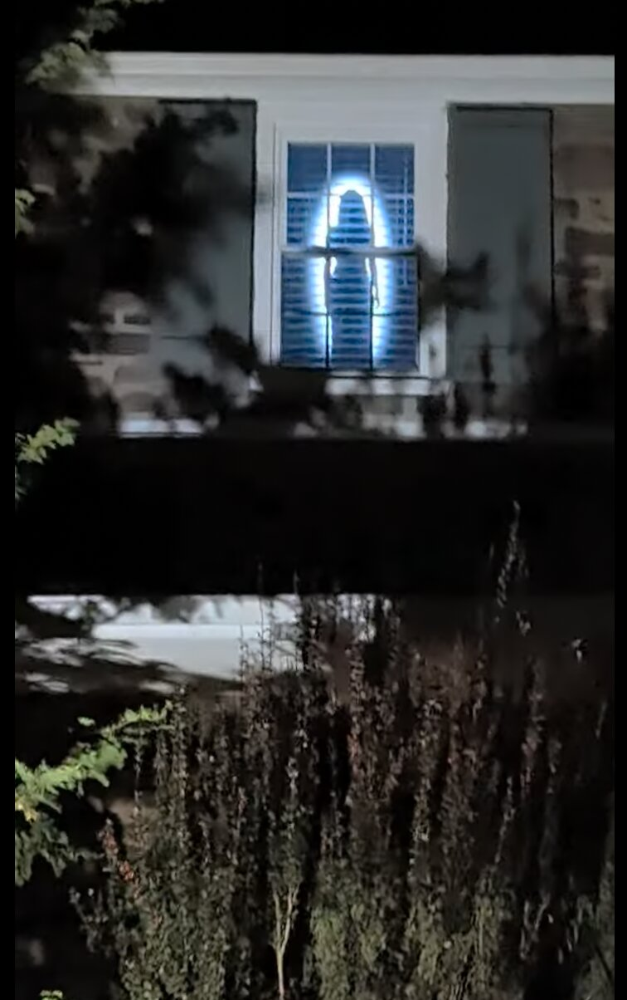

# Halloween Window Display

A shadowy woman appears in an upstairs window. She wanders past, vanishes, comes back and presses her hand against the glass. A gang of fuzzy, googly-eyed creatures crowds the window to stare out at the street, Mochi the dog trots up and turns into a glowing green-eyed ghost-dog, and later in the evening a glowing neon monster joins them, along with something that stands very still at the back of the room… until it doesn't. In November, Mochi comes back in a pilgrim hat, between views of a windswept autumn sunset.

It's a portrait TV standing behind a sheer curtain, driven by a Mac that plays AI-generated videos on a schedule: gentler ones while kids are out trick-or-treating, scarier ones later in the evening. Videos are grouped into seasons (Halloween, Thanksgiving, Christmas…), so each plays only during its part of the year.

<table align="center">
  <tr>
    <td align="center"></td>
    <td align="center"></td>
  </tr>
  <tr>
    <td align="center"><em>What trick-or-treaters see from the street</em></td>
    <td align="center"><em>What's playing on the TV</em></td>
  </tr>
</table>

**Contents**

1. [How it works](#how-it-works)
2. [Seasons](#seasons)
3. [Quick start](#quick-start)
4. [What you need](#what-you-need)
5. [The videos](#the-videos)
6. [Set up the Mac](#set-up-the-mac)
7. [Set up the window](#set-up-the-window)
8. [Override the schedule](#override-the-schedule)
9. [Day-to-day](#day-to-day)
10. [Troubleshooting](#troubleshooting)
11. [Files](#files)

## How it works


A Mac plays videos full-screen on a TV standing upright in the window, with a sheer curtain in front to hide the screen's edges. Two things decide what's on screen:

- **The season**, from today's date: Halloween videos in October, Thanksgiving in November, Christmas in December. See [Seasons](#seasons).
- **The daily schedule**, from the time of day: the `kid` playlist early in the evening, the `grownup` playlist later, and plain black the rest of the time.

The videos are kept in this repo, and the Mac pulls the latest at every login. A `show` command overrides the schedule.

## Seasons

Every video belongs to a season: a folder in [`playlists/`](playlists/) with a date range, optionally narrowed to certain weekdays plus extra days. The display only plays a season's videos on its days, so the window can change with the holidays without anyone touching the Mac.

### Seasons set up today

| Season | Dates | Folder | Videos |
|---|---|---|---|
| Halloween | Oct 1–31 | `playlists/halloween/` | 2 for all evening, plus 3 more in `grownup/` for grownup hours ([list](#the-videos)) |
| Thanksgiving | Fridays and Saturdays from Nov 1 until Thanksgiving, plus the day before and Thanksgiving Day | `playlists/thanksgiving/` | 2 for all evening: a fall sunset into night and Mochi the pilgrim ([list](#the-videos)) |
| Christmas | Dec 1–31 | `playlists/christmas/` | None yet: the window stays black |

### How a season is set up

A season is two things: an entry with its dates, and a folder of videos.

**1. Its dates**, in `CONFIG.seasons` near the top of [`scheduler/video_scheduler.js`](scheduler/video_scheduler.js):

```js
seasons: [
  { name: 'halloween', from: '10-01', to: '10-31' },
  {
    name: 'thanksgiving',
    from: '11-01',
    to: '11-4thu',                     // Thanksgiving: the 4th Thursday in November
    days: ['fri', 'sat'],              // only Friday and Saturday nights in between
    alsoOn: ['11-4thu-1', '11-4thu'],  // plus the day before and Thanksgiving Day
  },
  { name: 'christmas', from: '12-01', to: '12-31' },
],
```

| Setting | Meaning |
|---|---|
| `name` | The folder name in `playlists/`. |
| `from`, `to` | The first and last day. Both days count. |
| `days` | Optional. Only these weekdays between `from` and `to`: `'sun'` … `'sat'`, or full names like `'friday'`. Without it, every day. |
| `alsoOn` | Optional. Extra days that play whatever the weekday, even outside `from`–`to`. |

A day can be written like this:

| Written | Means | Example |
|---|---|---|
| `'MM-DD'` | That date every year | `'12-24'` |
| `'MM-<n><weekday>'` | The nth weekday of the month, so it's right every year; `last` for the last one | `'11-4thu'` Thanksgiving, `'05-lastmon'` Memorial Day |
| either, with `+N` or `-N` | That many days later or earlier | `'11-4thu-1'` the day before Thanksgiving |
| `'YYYY-MM-DD'` | One day, one year only (`alsoOn` only) | `'2026-11-14'` for a party |

So in 2026 Thanksgiving plays Nov 6, 7, 13, 14, 20, 21, then 25 and 26, and in 2027 it moves with the holiday to Nov 5, 6, 12, 13, 19, 20, 24 and 25. Every other day in November is black.

**2. Its videos**, in `playlists/<name>/`:

```
playlists/halloween/
├── fuzzy_creatures.mp4        ← plays in every scheduled period
├── mochi_ghost_dog.mp4
└── grownup/                   ← optional: plays only in 'grownup' periods
    ├── big_green_monster.mp4
    ├── jump_scare.mp4
    └── lady_silouette_long.mp4
```

During each period of the [daily schedule](#1-set-the-schedule), the display plays the videos directly in today's season folder **plus** those in the season's subfolder named after that period's playlist, if there is one, sorted together by file name. So on October 20:

| Time | Schedule | Plays |
|---|---|---|
| 6:00 pm | `kid` | `halloween/`: fuzzy creatures, Mochi (there's no `halloween/kid/`) |
| 8:00 pm | `grownup` | `halloween/` + `halloween/grownup/`: all five |
| noon | (none) | black |

A season with no subfolders plays the same videos all evening. A subfolder can be named after any playlist in the schedule, so `christmas/kid/` would hold Christmas videos just for the early evening.

**Rules**

- The season changes at midnight, so with `days: ['fri', 'sat']` a period running past midnight on Saturday stops at midnight.
- A season can run across New Year: `{ name: 'winter', from: '12-15', to: '01-06' }`.
- If two seasons overlap, the first one listed wins, so a short season (say `{ name: 'christmas-eve', from: '12-24', to: '12-24' }`) listed first takes over just its days.
- On a day no season covers, or in a season with no videos yet, the window stays black.
- A malformed entry is skipped and reported in the log.

### Adding a season

1. Add its entry to `CONFIG.seasons`.
2. Put its videos in `playlists/<name>/`, with `kid/` or `grownup/` subfolders for videos that should play only at those times.
3. Commit, push, and on the Mac run `git pull && bash scheduler/install.sh`.

To check a season's videos before its dates come round, preview them: `show christmas 5` plays the Christmas folder for five minutes, and `show christmas/grownup 5` adds its `grownup/` videos. See [Override the schedule](#override-the-schedule).

To play the same videos all year instead, set `seasons: []` and put playlist folders straight into `playlists/` (`playlists/kid/`, `playlists/grownup/`).

## Quick start

The videos are in this repo, so this is the whole Mac setup. Run it in Terminal, without `sudo`:

```sh
git clone https://github.com/ndipatri/HalloweenWindowDisplay.git ~/HalloweenWindowDisplay
cd ~/HalloweenWindowDisplay
bash scheduler/install.sh             # installs, copies the videos into ~/video-scheduler, starts
~/video-scheduler/show kid 5          # try it now: kid for 5 minutes
```

Then rotate the display to portrait, turn on automatic login, and turn off the TV's auto power-off ([details](#5-macos-settings)). To change the hours, see [Set the schedule](#1-set-the-schedule); for the dates, see [Seasons](#seasons). To play something outside the schedule, see [Override the schedule](#override-the-schedule).

## What you need

- A TV or monitor that can stand vertically (this build uses 1080 × 1920).
- A Mac connected to it over HDMI. Any Mac that runs a recent macOS works.
- A sheer white or grey curtain for the window.

## The videos

**[Halloween](#seasons)** (October 1–31):

| Folder | Plays | Video | Length |
|---|---|---|---|
| `halloween/` | all evening | `fuzzy_creatures.mp4`: a gang of shaggy, googly-eyed fuzzy creatures runs around the room, then crowds the window, faces pressed to the glass | 0:20 |
| `halloween/` | all evening | `mochi_ghost_dog.mp4`: Mochi, a real fluffy white dog, trots up to the window and turns into a friendly ghost-dog with glowing green eyes and little horns, then floats away | 0:20 |
| `halloween/grownup/` | grownup only | `big_green_monster.mp4`: a glowing neon monster comes right up to the glass and stares out | 0:20 |
| `halloween/grownup/` | grownup only | `jump_scare.mp4`: a pale, gaunt figure stands motionless far back in the dark for a long moment, then suddenly charges and slams against the glass, its hollow-eyed, screaming face filling the window. No blood | 0:20 |
| `halloween/grownup/` | grownup only | `lady_silouette_long.mp4`: a shadowy woman walks past, presses her hand to the glass, and keeps coming back | 1:33 |

So during the `kid` hours it's the fuzzy creatures and Mochi; during `grownup` hours, all five.

**[Thanksgiving](#seasons)** (November 1–30):

| Folder | Plays | Video | Length |
|---|---|---|---|
| `thanksgiving/` | all evening | `fall_dusk.mp4`: a classic autumn dusk: the sun sinks into the hills behind red maples losing their leaves, wind blows leaves across the window and ripples the long grass, then the sun slips below the hills, the sky fades through purple to deep blue, and a pale moon rises over the field | 0:25 |
| `thanksgiving/` | all evening | `mochi_pilgrim.mp4`: Mochi trots up in a little pilgrim hat, gazes out at the street, then spots a floating roast drumstick and chases it out of frame | 0:20 |

They're in [`playlists/`](playlists/), 1080 × 1920, silent, and each starts and ends on black so it loops without a visible jump. The woman and the monster are lowered 20% on screen so they stand at window height; the fuzzy creatures, both Mochis and the jump scare fill the whole frame. The jump scare has no flicker, so nothing spoils the still build-up or the moment it strikes, and the Thanksgiving videos have none because they're meant to be cozy, not spooky. The fall dusk scene is two generations, the 15-second dusk and a 10-second extension that carries it on into night, joined with a short dissolve. It fades in from black and out to black so it loops smoothly, and was cropped slightly to remove a window frame the model drew around it.

### How they were made

The videos were made in a conversation with [Claude](https://claude.ai), Anthropic's AI assistant, connected to [Higgsfield](https://higgsfield.ai), an AI video service, through Higgsfield's connector (MCP). The person described what they wanted in plain words and reacted to each result; Claude turned that into prompts, generations and edits, and they went back and forth until it looked right:

1. **Describe the idea.** For example: "a woman who's just a dark silhouette, on black, walking in and out of frame, on a portrait TV in my window."
2. **Claude writes the prompt and generates.** It picked the model (Seedance 2.5, text-to-video), set the format (9:16, 1080p, 12–20 s, no audio), checked the credit cost, wrote the detailed prompt below, and started the generation on Higgsfield. For Mochi, a photo of the real dog was uploaded to Higgsfield and used as a reference image (Seedance 2.5's image-reference mode), so the video shows him rather than a generic white dog.
3. **Check the result.** Claude pulled frames from the clips to check the figure filled the frame and each clip started and ended on black, and the person watched them.
4. **Iterate on feedback.** "She should be much bigger, right at the window" led to a new prompt. "Lower her 20%, the window isn't at floor level" and "make it scarier" led to editing rather than regenerating: Claude used ffmpeg, in Higgsfield's cloud sandbox, to lower the picture, add a flicker and glitch flashes, and join the woman's two clips into one loop. The new hand-on-the-glass clip was the only extra generation. "Too much dead space" cut the loop from 4:20 to 1:33.
5. **Ship it.** Claude committed the finished videos here, along with the scheduler, installer and this README.

To make new videos the same way, you need a Higgsfield account, a Claude plan, and ffmpeg (`brew install ffmpeg`) to run `video/build_loop.sh`.

### What it cost

**About $143 for the videos**, plus a **Claude subscription** (from $20 a month). Prices in US dollars, as of October 2026.

**Higgsfield** charges per generation; editing afterwards costs nothing. Ten generations were made:

| Generation | Cost (USD) |
|---|---|
| Woman walking, first try (too small, discarded) | $13.07 |
| Woman walking, second try (used) | $13.07 |
| Woman, hand on the glass | $7.84 |
| Neon monster | $13.07 |
| Fuzzy creatures | $17.78 |
| Mochi the ghost-dog | $17.78 |
| Jump scare | $17.78 |
| Mochi the pilgrim | $18.82 |
| Fall dusk (15 s) | $14.12 |
| Fall dusk, extended into night (10 s) | $9.41 |
| **Total** | **$142.73** |

- By video: the woman's loop cost **$33.97** (including the discarded try), the monster **$13.07**, the fuzzy creatures **$17.78**, Mochi **$17.78**, the jump scare **$17.78**, Mochi the pilgrim **$18.82**, the fall dusk **$23.53** (dusk plus the night extension).
- Higgsfield sells credits, and every 20-second 1080p Seedance 2.5 clip costs the same 320 credits; the dollar cost depends on how the credits were bought. The first four used credits from the **Plus plan, $49 a month for 1,200 credits** (about $0.04 each, or $0.65 per second of video). The fuzzy creatures, Mochi and the jump scare used a **1,000-credit top-up for $55.56** (about $0.056 each, or $0.89 per second), and Mochi the pilgrim and the fall dusk a **500-credit top-up for $29.41** (about $0.059 each). The fall dusk is 15 seconds, so it took 240 credits rather than 320, and its 10-second night extension 160, from a second 500-credit top-up.
- Free after generation: lowering the picture 20%, the flicker and glitch flashes, fading the monster's top edge, and cutting the loop from 4:20 to 1:33.

**Claude** is a flat monthly subscription, not charged per video, so the conversation that wrote the prompts, checked and edited the videos, and wrote the scheduler, installer and this README cost nothing beyond the plan:

| Plan | Price | Usage |
|---|---|---|
| Free | $0 | Limited |
| Pro | $20/month ($17/month billed yearly) | Baseline |
| Max | $100/month | 5× Pro |
| Ultra | $200/month | 10× Pro |

All plans include connectors such as Higgsfield. A long working session like this one, spread over a couple of days, can reach Pro's usage limits; a higher plan gives more room.

Sources: [Higgsfield pricing (Oct 2026)](https://higgsfield.ai/blog/higgsfield-pricing-explained) · [Claude plans & pricing](https://claude.com/pricing)

### The prompts

**Fall dusk (15 s)**

> Static locked-off camera, vertical frame, a classic New England autumn landscape at dusk, seen as if looking out of a window. In the foreground and middle ground, tall old maple and oak trees in full fall color, deep red, burnt orange and gold, already half bare, with dark branches showing through. Beyond them a gently rolling field of long golden grass and a distant line of hills. The sun is low and failing, a large soft orange disc sinking toward the hills, casting long shadows and a warm red-orange glow across the horizon, the sky fading from amber near the horizon to deep violet and dusky blue above, a few streaky clouds lit pink and orange. A steady autumn wind blows: branches sway, leaves loosen and break away from the trees, and many red, orange and yellow leaves drift, flutter and tumble through the air across the frame, some passing close to the camera, the long grass ripples in waves. Slowly, over the clip, the light dims a little as the sun sinks lower. Peaceful, nostalgic, cinematic, rich warm colors, photorealistic, no people, no animals, no buildings, no text, no camera movement.

"Seen as if looking out of a window" made the model draw a window frame; leave it out next time.

**Fall dusk, extended into night (10 s)**, Seedance 2.5's video-extension mode, continuing forward from the end of the dusk clip

> Continue the same shot exactly: the same static locked-off camera, the same autumn landscape with the red maples, the rolling golden field and the distant hills, the same framing. The sun keeps sinking and slips completely below the hills; the last sliver of orange disappears. The red-orange glow on the horizon fades to a thin band of deep amber, then to dusky purple and finally deep navy blue night. The trees and hills turn into dark silhouettes against the sky. Stars slowly appear and twinkle across the darkening sky, and a soft pale moon glows low in the sky, casting faint silver light on the field. The wind keeps blowing: branches sway, and leaves keep drifting and tumbling through the air, now catching faint moonlight. Ends on a calm, peaceful, dark autumn night. Smooth, gradual, photorealistic, no people, no animals, no buildings, no text, no camera movement.

**Mochi the pilgrim (20 s)**, with the same photo of Mochi as the reference image

> The dog is the small white fluffy dog from the reference image: curly bright white coat, round fluffy head, floppy ears, dark round eyes, black button nose, plumed curly tail. Keep his exact look and breed. Ignore the room, couch and poster in the reference. Static locked-off camera, vertical frame, pure black background, no environment, no floor. The camera is right at a window looking into a dark room. The video begins on an empty, fully black frame. The little white dog appears far back in the darkness, warmly lit by a soft golden autumn glow, wearing a small black pilgrim hat with a shiny gold buckle, and happily trots toward the window, tail wagging, ears bouncing. He arrives right at the glass, extremely close to camera, his fluffy face filling most of the frame under the little pilgrim hat, nose pressed to the glass, big hopeful eyes, tilting his head at the street, adorable and funny. Then a golden roasted turkey drumstick floats slowly through the air just in front of him. His eyes lock onto it, his ears perk up, and he spins around and bounds off after it, chasing it excitedly out of frame. The frame fades back into darkness. The final seconds are an empty, fully black frame, identical to the opening. Warm cozy Thanksgiving mood, playful and funny, kid-friendly, warm golden and amber light on pure black, high contrast, no text, no humans, no other animals, no camera movement.

**Jump scare (20 s)**

> Static locked-off camera, vertical frame, pure black background, no environment, no floor, no light sources. The camera is right at a window looking into a pitch-dark room. The video begins on an empty, fully black frame. Slowly, far at the very back of the darkness, a tall pale gaunt figure becomes barely visible, standing perfectly still, arms hanging limp, head slightly tilted, faint cold grey light on its pale skin, so faint you are not sure it is there. It stays completely motionless for a long, tense moment. Then, without warning, it suddenly sprints straight at the camera at terrifying, unnatural speed, jerky and twitching, and SLAMS against the glass, extremely close to camera: its face fills the entire frame, an emaciated ash-white face with cracked dry skin, completely black hollow eyes with no pupils, jaw stretched impossibly wide open in a silent scream, stringy dark hair, long bony spidery fingers splayed and slapping against the glass on both sides of the face. It stays pressed against the glass, twitching violently, head jerking, staring straight into the viewer. Then it snaps backward into the darkness in an instant and is gone, leaving pitch black. The final seconds are an empty, fully black frame, identical to the opening. Horror jump scare, terrifying, sudden, cold desaturated grey tones on pure black, high contrast, no blood, no gore, no wounds, no text, no other people, no camera movement.

**Mochi the ghost-dog (20 s)**, with a photo of Mochi attached as the reference image

> The dog is the small white fluffy dog from the reference image: curly bright white coat, round fluffy head, floppy ears, dark round eyes, black button nose, plumed curly tail. Keep his exact look and breed. Ignore the room, couch and poster in the reference. Static locked-off camera, vertical frame, pure black background, no environment, no floor, no light sources. The camera is right at a window looking into a pitch-dark room. The video begins on an empty, fully black frame. The little white dog appears far back in the darkness, small, softly lit, and happily trots toward the window, tail wagging. As he gets closer he magically transforms into a friendly cartoon ghost-dog: his white fur becomes softly translucent and glows a gentle pale blue-white with wisps of ghostly mist trailing off his fur, his eyes light up bright glowing green, and two small rounded stubby horns sprout on top of his head. Cute and funny, not scary. He arrives right at the glass, extremely close to camera, his fluffy glowing ghost face filling most of the frame, green eyes glowing, tilting his head curiously, nose squishing against the glass and fogging it with a breath, giving a goofy happy grin. He holds there, peering out at the street. Then he floats backward into the darkness of the room, his glow fading and shrinking until he dissolves completely into the black. The final seconds are an empty, fully black frame, identical to the opening. Playful, funny, gently spooky Halloween for kids, high contrast on pure black, no text, no humans, no other animals, no camera movement.

**Fuzzy creatures (20 s)**

> Static locked-off camera, vertical frame, pure black background, no environment, no floor, no light sources. The camera is right at a window looking into a pitch-dark room. The video begins on an empty, fully black frame. A gang of six shaggy, fuzzy, handmade puppet-like creatures appears in the darkness of the room: long wild shaggy fur in vivid saturated colors, one lime green, one hot pink, one electric blue, one bright orange, one purple, one yellow; big round googly eyes with small black pupils, wide floppy felt mouths, some with little horns, antennae or droopy ears, gangly arms. They are lit only by soft colored rim light against pitch black. They scamper and run around the room behind the glass, tumbling, bouncing, chasing each other and bumping into one another, playful and chaotic. Then all at once they notice the window, freeze, and rush forward together, converging on the glass and crowding against it, extremely close to camera: their fuzzy faces fill the entire frame from edge to edge, squished together, fur pressed against the glass, big googly eyes peering out at the street, blinking, mouths agape, jostling for space, mischievous and curious. They hold there, staring out. Then they slowly back away together, retreating into the darkness of the room, shrinking and fading until they dissolve completely into the black. The final seconds are an empty, fully black frame, identical to the opening. Handcrafted fuzzy puppet aesthetic, playful but eerie Halloween mood, high contrast, saturated colors on pure black, no text, no humans, no camera movement.

**Woman, walk (20 s)**

> Static locked-off camera, vertical frame, pure black background, no environment, no floor, no light sources. The camera is right at a window looking into a dark room, and the woman stands directly against the glass, extremely close to camera. Her figure is huge and fills the entire height of the frame: the top of her head touches the top edge of the frame and her body extends down past the bottom edge. She is a solid jet-black silhouette, a featureless dark shape with only a faint soft grey rim of backlight tracing her outline: long hair, shoulders, a long dress. No face, no eyes, no details, no color. The video begins on an empty, fully black frame. She slowly steps in from the left edge, close to the glass and still filling the full frame height, drifts across, stops in the center facing the viewer as if pressed to the window staring out, sways slightly and tilts her head, then slides out of frame on the right. She re-enters from the right, again full height and close to the glass, then turns and slowly walks back into the darkness of the room, shrinking and fading until she dissolves into the black. The final seconds are an empty, fully black frame, identical to the opening. Slow, eerie, ghostly, unhurried, smooth movement. Minimal, haunting, high contrast, no text, no other people, no camera movement.

**Woman, hand on the glass (12 s)**

> Static locked-off camera, vertical frame, pure black background, no environment, no floor, no light sources. The camera is right at a window looking into a dark room. The video begins on an empty, fully black frame. A woman slowly emerges out of the darkness and stops directly against the glass, extremely close to camera, her figure huge and filling the entire height of the frame: the top of her head touches the top edge of the frame and her body extends past the bottom edge. She is a solid jet-black silhouette, a featureless dark shape with only a faint soft grey rim of backlight tracing her outline: long tangled hair, shoulders, a long dress. No face, no eyes, no details, no color. She stands perfectly, unnaturally still. Then her head slowly tilts downward, as if she has noticed someone on the street below. She slowly raises one hand and presses her palm flat against the glass, fingers spread, the hand silhouette large in the frame. She holds there, motionless. Suddenly her head snaps sharply to one side with a jerky, unnatural movement. Then she slowly sinks backward into the darkness and dissolves completely into the black. The final second is an empty, fully black frame. Eerie, unsettling, horror, high contrast, no text, no other people, no camera movement.

**Monster (20 s)**

> Static locked-off camera, vertical frame, pure black background, no environment, no floor, no light sources. The camera is right at a window looking into a pitch-dark room. The video begins on an empty, fully black frame. A tall, gaunt, terrifying monster slowly steps in from the left edge, directly against the glass, extremely close to camera. It is huge and fills the entire height of the frame: the top of its head touches the top edge of the frame and its body extends down past the bottom edge. The monster is vividly colorful against the blackness: slick iridescent skin shifting from toxic green to deep violet and magenta, glowing bioluminescent orange stripes and spots pulsing along its ribs and long arms, a crest of jagged cyan spines down its back, a wide mouth of crooked needle teeth, and two large glowing yellow eyes. Long spindly fingers with hooked claws. It is lit only by its own glow and a faint colored rim light, everything around it pitch black. It moves slowly and unnaturally, with jerky, twitching steps. It drifts across, stops in the center facing the viewer as if staring out the window, cocks its head, slowly breathes, then slides out of frame on the right. It re-enters from the right, close to the glass and still filling the full frame height, then turns and slowly retreats backward into the darkness of the room, shrinking as its glow dims until it dissolves completely into the black. The final seconds are an empty, fully black frame, identical to the opening. Eerie, menacing, horror, high contrast, saturated neon colors on pure black, no text, no other creatures or people, no camera movement.

## Set up the Mac

### 1. Set the schedule

The season dates are covered under [Seasons](#seasons). **The schedule**, `CONFIG.schedule` near the top of `scheduler/video_scheduler.js`, says when the screen is on each day and which playlist plays. Each period has a start and stop time in 24-hour `HH:MM` and the `playlist` to play.

```js
schedule: [
  { start: '05:00', stop: '07:00', playlist: 'kid' },
  { start: '17:00', stop: '19:30', playlist: 'kid' },
  { start: '19:30', stop: '23:00', playlist: 'grownup' },
],
```

This is the default: gentler videos in the early morning and during trick-or-treating, scarier ones once the little kids are home. Adjust the times to your street.

- Outside these times the screen shows black.
- Periods can cross midnight (`{ start: '23:00', stop: '01:00', playlist: 'grownup' }`). If periods overlap, the first one listed wins.
- A period can be limited to some weekdays: `{ start: '09:00', stop: '11:00', playlist: 'kid', days: ['sat', 'sun'] }` adds weekend mornings. A period that crosses midnight belongs to the day it starts on. To choose which *days* the window is on at all, set `days` and `alsoOn` on the [season](#how-a-season-is-set-up) instead.
- During a period, today's season's own videos play, plus any in its subfolder named after the playlist, e.g. `halloween/grownup/` ([details](#how-a-season-is-set-up)).
- Each playlist resumes where it left off. Above, the evening `kid` period carries on from where the morning one stopped.
- `playlist` is just a name, so you can add more playlists by naming one in the schedule and giving seasons a subfolder for it.
- A malformed entry is skipped and reported in the log.

You can change the schedule or the season dates any time later; run the installer again afterwards.

### 2. Install

```sh
bash scheduler/install.sh
```

Don't use `sudo`. The installer:

- copies the scheduler, the [`show` command](#override-the-schedule) and the [`sync` command](#3-add-the-videos) to `~/video-scheduler/`
- writes the launch agent with your home folder filled in, checks it, and starts it, which also copies the videos from the repo

It starts again by itself at every login, syncing the videos first. Run the installer again after any change to the script or schedule. It restarts the running copy with the new version; any override is kept.

> [!IMPORTANT]
> Keep the repo itself out of **Desktop**, **Documents** and **Downloads** (for example at `~/HalloweenWindowDisplay`). The installer warns you if it isn't: at login, macOS may not let the scheduler read those folders, so videos wouldn't sync.

### 3. Add the videos

The videos are kept in this repo, one folder per season, and copied to the Mac:

```
HalloweenWindowDisplay/playlists/        in the repo: the master copy
├── halloween/                           Oct 1–31
│   ├── fuzzy_creatures.mp4              ← every scheduled period
│   ├── mochi_ghost_dog.mp4
│   └── grownup/                         ← 'grownup' periods only (optional)
│       ├── big_green_monster.mp4
│       ├── jump_scare.mp4
│       └── lady_silouette_long.mp4
├── thanksgiving/                        Fri & Sat until Thanksgiving, then Wed & Thu
│   ├── fall_dusk.mp4
│   └── mochi_pilgrim.mp4
└── christmas/                           Dec 1–31

~/video-scheduler/                       on the Mac: what actually plays
├── halloween/ · thanksgiving/ · …       copies of the seasons above
├── .removed/                            videos taken out of the repo, set aside
├── video_scheduler.js · start · sync · show
├── scheduler.log
├── status                               what's on screen now (written by the scheduler)
└── override.json                        only while an override is in force (written by show)
```

**To add, replace or remove a video**, change it in the repo and push. On the Mac:

```sh
cd ~/HalloweenWindowDisplay
cp ~/Downloads/new-ghost.mp4 playlists/halloween/          # or playlists/halloween/grownup/
git add playlists && git commit -m "Add new-ghost" && git push
~/video-scheduler/sync          # or wait for the next login
```

`sync` pulls the latest from GitHub, then for each folder under `playlists/` (seasons and their subfolders):

- copies in videos that are new or changed;
- moves videos that are no longer in the repo, including a whole subfolder deleted from a season, to `~/video-scheduler/.removed/`. It never deletes anything.

Top-level folders that aren't in the repo are left alone, so you can still keep a local-only season. The running scheduler picks the changes up by itself. If GitHub can't be reached, or doesn't answer within a minute, `sync` uses the videos already in the repo and the display carries on; it's all in the log.

> [!WARNING]
> Once a season folder (say `playlists/christmas/`) exists in the repo, it's the master copy: videos in that season on the Mac that aren't in the repo are moved to `.removed/` at the next sync. Commit all your videos before relying on sync.

At login it syncs at most once every 10 minutes, so a scheduler that keeps crashing doesn't keep hitting GitHub; `~/video-scheduler/sync` always syncs. GitHub refuses files over 100 MB, so keep each video under that (the ones here are 18–28 MB).

- Videos play one after another, then start over from the first. Order is by file name, with numbers sorted as numbers (`2-…` before `10-…`), so a number prefix controls the order.
- `.mp4`, `.m4v` and `.mov` files are played; anything else in the folder is ignored.
- New videos are picked up within a few seconds, and videos you add or remove later are picked up as the playlist moves on. No restart needed.
- Videos are copied in under a hidden name and renamed into place, so a half-copied file is never played.
- A playlist with a single video simply loops it.
- A season with no videos shows black during its periods.

### 4. Check it's working

```sh
tail -f ~/video-scheduler/scheduler.log
```

You should see lines like:

```
10/31/2026, 5:00:00 PM  Now showing: halloween/kid (scheduled until 7:30 PM)
10/31/2026, 5:00:01 PM  halloween/kid: playing fuzzy_creatures.mp4
10/31/2026, 5:00:21 PM  halloween/kid: playing mochi_ghost_dog.mp4
10/31/2026, 7:30:00 PM  Now showing: halloween/grownup (scheduled until 11:00 PM)
```

Outside the schedule it logs, for example, `Now showing: black (outside schedule until 5:00 PM)`, and on a day no season covers, `black (no season today, Jan 15)`. Press Control-C to stop watching the log; the scheduler keeps running.

To see a playlist right now without waiting for its time, override the schedule for a few minutes:

```sh
~/video-scheduler/show kid 5
```

### 5. macOS settings

| Setting | Where | Why |
|---|---|---|
| Rotate the display to portrait | System Settings → Displays → Rotation | The scheduler only uses a display that is taller than it is wide |
| Automatic login | System Settings → Users & Groups | The scheduler runs only while you're logged in. Not available while FileVault is on |
| Do Not Disturb on a schedule | System Settings → Focus → Do Not Disturb → Add Schedule | Stops notifications appearing over her |
| Don't auto-install macOS updates | System Settings → General → Software Update → Automatic Updates | An overnight update restart can leave the Mac at a login or setup screen |

## Set up the window

- **Hang the sheer curtain between the glass and the TV.** It hides the screen's edges and turns her into a blurry shape behind fabric. This helps more than anything else.
- **Turn every light in the room off** so nothing gives away that it's a screen.
- **Turn the TV's brightness down** until she's only just visible from the street. A dim figure reads as real; a bright one reads as a TV.
- **Turn off the TV's auto power-off.** Many TVs switch themselves off after about 4 hours without a remote button press. Look for "Auto Power Off", "Eco" or "4-hour off" in the TV's settings.
- Check it from the street after dark and adjust.

## Override the schedule

The `show` command plays something other than what the schedule says, right now. The scheduler picks it up within a second; there's nothing to restart.

```sh
show                           # what's on screen now, and why
show grownup 30                # grownup for 30 minutes, then back to the schedule
show kid                       # kid until the schedule next changes
show christmas/kid 5           # preview another season's kid videos for 5 minutes
show christmas 5               # preview just a season's own videos
show off                       # black until the schedule next changes
show grownup --until-cleared   # grownup until you say otherwise
show schedule                  # cancel any override; follow the schedule
```

```
$ show grownup 30
Showing grownup until 6:42 PM, then back to the schedule.
Now showing: halloween/grownup (override until 6:42 PM)
```

How long an override lasts:

| You type | It lasts until |
|---|---|
| `show grownup 30` | 30 minutes from now |
| `show grownup` | The schedule next changes. At 6 pm during `kid` (5–7:30 pm), that's 7:30 pm, when `grownup` starts anyway. Outside the schedule, it's the start of the next period |
| `show grownup --until-cleared` | You run `show schedule`, however long that is |

Overrides end by themselves unless you ask otherwise. That way a forgotten override can't leave the scary videos on at 7 am. An override survives a restart of the Mac, and each playlist still resumes where it left off.

`show` lives at `~/video-scheduler/show`. To type just `show`, add an alias once, then open a new Terminal window:

```sh
echo "alias show='$HOME/video-scheduler/show'" >> ~/.zshrc
```

A plain playlist name (`kid`, `grownup`) means today's season's. To check another season's videos before its dates, name it: `show christmas/grownup 5`. `show` warns about a name that matches no folder, which is usually a typo.

## Day-to-day

| Task | How |
|---|---|
| Play something else right now | `show grownup 30`, `show off`, `show schedule` (see [Override the schedule](#override-the-schedule)) |
| See what's on screen | `show` |
| Add, remove or reorder videos | Change them in the repo's `playlists/<season>/` folder, commit and push, then `~/video-scheduler/sync` (or wait for the next login) |
| Add a season | Create `playlists/<name>/` with videos, add `{ name, from, to }` to `CONFIG.seasons`, push, then `bash scheduler/install.sh` |
| Preview a season early | `show christmas 5`, or `show christmas/grownup 5` |
| Get the latest videos now | `~/video-scheduler/sync` |
| Undo a removal | Move the file back from `~/video-scheduler/.removed/` and put it back in the repo |
| Change the schedule or season dates | Edit `scheduler/video_scheduler.js`, then run `bash scheduler/install.sh` |
| Get the latest version of this repo | `git pull`, then `bash scheduler/install.sh` |
| Restart | `launchctl kickstart -k gui/$(id -u)/com.user.videoscheduler` |
| Stop | `launchctl bootout gui/$(id -u)/com.user.videoscheduler` (starts again at next login) |
| Remove for good | Stop it, then `rm ~/Library/LaunchAgents/com.user.videoscheduler.plist` |
| Quit right now | Control-C on the display (click it first). Stays off until the next login or restart |
| See what it's doing | `cat ~/video-scheduler/scheduler.log` |

## Troubleshooting

Start with the log: `cat ~/video-scheduler/scheduler.log`. It records what's showing and why whenever that changes, each video as it starts, overrides starting and ending, and any problem with a folder or file. For just the current state, run `show`.

| Problem | Fix |
|---|---|
| Log says `No folder …, so showing black` | That season has no folder on the Mac: either it has no videos yet (expected), or its name doesn't match `CONFIG.seasons`. Check `playlists/<season>/` is in the repo and run `~/video-scheduler/sync` |
| Status says `no season today` | No season in `CONFIG.seasons` covers today's date. Add one, or extend a season's dates |
| Log says `No videos for …` | That season (and its playlist subfolder) has no `.mp4`, `.m4v` or `.mov` files yet. Add some to the repo and sync |
| Log says `Skipping …` | That file is damaged or in a format macOS can't play. Re-export it as H.264 MP4; the others keep playing |
| Black screen, log says `playing …` | Check the TV's input and brightness, and that the curtain isn't too thick |
| Screen isn't following the schedule | An override is probably in force. Run `show` to check, `show schedule` to cancel it |
| Log says `Couldn't pull from GitHub` | The Mac is offline or GitHub can't be reached; it plays the videos it already has. Check the network, then run `~/video-scheduler/sync`. If the reason mentions local changes, see [Updating](#day-to-day) |
| A video I added doesn't play | Check it's committed and pushed (`git status`), then run `~/video-scheduler/sync` and look for `Copied …` |
| A video disappeared from the Mac | It isn't in the repo's `playlists/` folder, so sync moved it to `~/video-scheduler/.removed/`. Add it to the repo |
| `show` says `No status yet` | The scheduler isn't running, or hasn't started since the last update. Run `bash scheduler/install.sh` |
| Log says `Ignoring …/override.json` | The override file was edited by hand and is malformed. Run `show schedule` to delete it |
| Log says `Ignoring schedule entry` or `Ignoring season entry` | Fix that entry: times must be `HH:MM` with a `playlist`; seasons need a `name` and real `MM-DD` dates |
| Nothing on the TV at all; the Mac desktop shows | The display isn't rotated to portrait, or the agent isn't running: `launchctl print gui/$(id -u)/com.user.videoscheduler` |
| TV turns itself off in the evening | Disable the TV's auto power-off (see above) |
| `Bootstrap failed: 5: Input/output error` | An older installer started the new copy before the old one had stopped. `git pull` and run `bash scheduler/install.sh` again |
| Installer says `still loaded after 10 seconds` | macOS didn't release the old copy. Log out and back in; the scheduler starts by itself at login |

## Files

| Path | What it is |
|---|---|
| `scheduler/video_scheduler.js` | Plays the season's scheduled playlist full-screen on the portrait display |
| `scheduler/com.user.videoscheduler.plist` | Launch agent template: starts the script at login and restarts it if it crashes |
| `scheduler/show.sh` | The `show` command for overriding the schedule (installed as `~/video-scheduler/show`) |
| `scheduler/start.sh` | Run at login: syncs the videos, then starts the scheduler (installed as `~/video-scheduler/start`) |
| `scheduler/sync_videos.sh` | Pulls the repo and copies `playlists/` into `~/video-scheduler` (installed as `~/video-scheduler/sync`) |
| `scheduler/install.sh` | Installs or updates the scheduler for the current user |
| `scheduler/tests/` | Tests for the scheduler's logic: `node scheduler/tests/scheduler.test.js` |
| `playlists/` | The videos, one folder per season, with optional playlist subfolders |
| `video/build_loop.sh` | Builds the 1:33 loop from the two generated clips |
| `docs/images/` | Frames and diagrams used in this guide |
