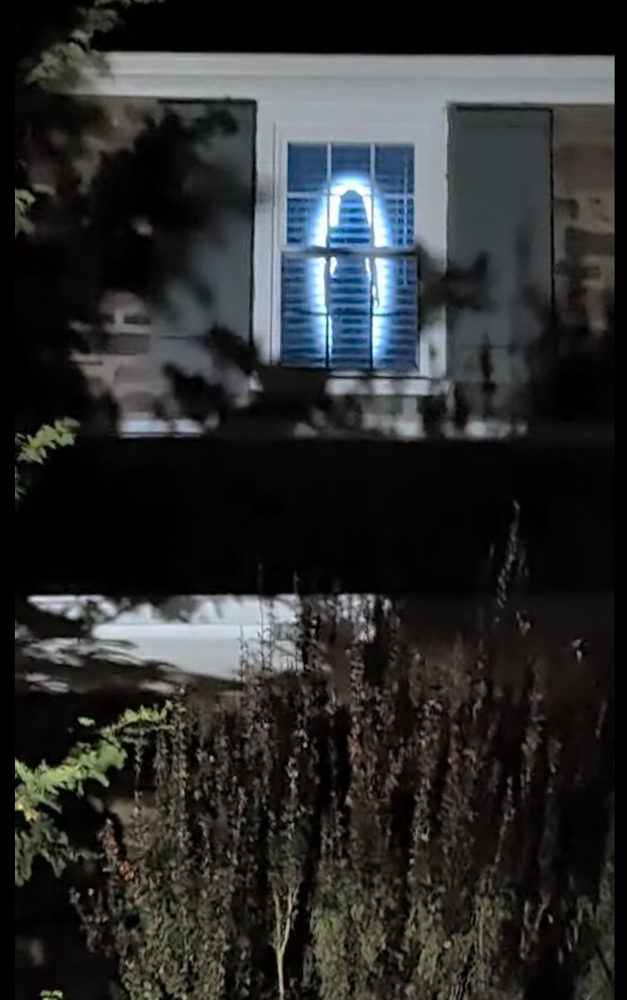
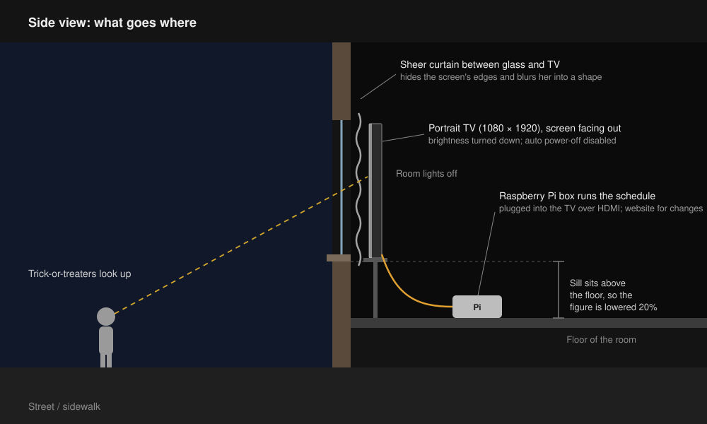

# Halloween Window Display

A shadowy woman appears in an upstairs window. She wanders past, vanishes, comes back and presses her hand against the glass. A gang of fuzzy, googly-eyed creatures crowds the window to stare out at the street, Mochi the dog trots up and turns into a glowing green-eyed ghost-dog, and later in the evening a glowing neon monster joins them, along with something that stands very still at the back of the room… until it doesn't. In November, Mochi comes back in a pilgrim hat, between views of an autumn sunset that fades into a moonlit night and a calmer one where the sun hangs still over the hills while the leaves keep falling.

It's a portrait TV standing behind a sheer curtain, driven by a small Raspberry Pi box that plays AI-generated videos on a schedule: gentler ones while kids are out trick-or-treating, scarier ones later in the evening. The videos change with the seasons: Halloween, Thanksgiving, Christmas.

<table align="center">
  <tr>
    <td align="center"></td>
    <td align="center"></td>
  </tr>
  <tr>
    <td align="center"><em>What trick-or-treaters see from the street</em></td>
    <td align="center"><em>What's playing on the TV</em></td>
  </tr>
</table>

**Contents**

1. [How it works](#how-it-works)
2. [What's playing](#whats-playing)
3. [The videos](#the-videos)
4. [Set it up](#set-it-up)
5. [Using it](#using-it)
6. [If something's wrong](#if-somethings-wrong)

## How it works



A Raspberry Pi box, plugged into the TV's HDMI, plays videos full-screen on a TV standing upright in the window, with a sheer curtain in front to hide the screen's edges. Two things decide what's on screen:

- **The season**, from the date: Halloween videos in October, Thanksgiving in November, Christmas in December.
- **The time of day**: gentler "kid" videos in the early morning and early evening, scarier "grownup" ones later, and a black screen the rest of the time.

The videos are kept in this repo, and the box picks up the latest by itself every hour. A page on your phone shows what's playing and lets you change it for a while.

## What's playing

| Season | When | Videos |
|---|---|---|
| Halloween | Every day in October | Kid hours: the fuzzy creatures and Mochi the ghost-dog. Grownup hours: those two plus the monster, the jump scare and the woman |
| Thanksgiving | Fridays and Saturdays in November until Thanksgiving, then the day before and Thanksgiving Day itself | The fall sunset, Mochi the pilgrim and the steady fall sun, all evening |
| Christmas | December | None yet, so the window stays black |

Each day:

| Time | Playing |
|---|---|
| 5–7 am | Kid videos |
| 5–7:30 pm | Kid videos |
| 7:30–11 pm | Grownup videos |
| Any other time | Black |

On a day outside every season, the window stays black. The dates and times can be changed; they're set in `scheduler/config.js`.

## The videos

**Halloween**

| Video | Plays | Length |
|---|---|---|
| **Fuzzy creatures:** a gang of shaggy, googly-eyed creatures runs around the room, then crowds the window, faces pressed to the glass | Kid and grownup hours | 0:20 |
| **Mochi the ghost-dog:** Mochi, a real fluffy white dog, trots up to the window and turns into a friendly ghost-dog with glowing green eyes and little horns, then floats away | Kid and grownup hours | 0:20 |
| **Neon monster:** a glowing neon monster comes right up to the glass and stares out | Grownup hours | 0:20 |
| **Jump scare:** a pale, gaunt figure stands motionless far back in the dark for a long moment, then suddenly charges and slams against the glass, its screaming face filling the window. No blood | Grownup hours | 0:20 |
| **The woman:** a shadowy woman walks past, presses her hand to the glass, and keeps coming back | Grownup hours | 1:33 |

**Thanksgiving**

| Video | Plays | Length |
|---|---|---|
| **Fall sunset:** the sun sinks into the hills behind red maples losing their leaves, wind blows leaves across the window, then the sky fades through purple to deep blue and a pale moon rises over the field | All evening | 0:25 |
| **Mochi the pilgrim:** Mochi trots up in a little pilgrim hat, gazes out at the street, then spots a floating roast drumstick and chases it out of frame | All evening | 0:20 |
| **Steady fall sun:** the same sunset, but calm: the sun stays just above the hills, the light never changes, and red and orange leaves keep drifting past the window the whole time | All evening | 0:23 |

The videos play one after another and start over, each fading in from black and back out, so there's no visible jump between them.

### How they were made

The videos were made in a conversation with [Claude](https://claude.ai), Anthropic's AI assistant, connected to [Higgsfield](https://higgsfield.ai), an AI video service. The ideas were described in plain words ("a woman who's just a dark silhouette, walking in and out of the window"); Claude wrote the detailed prompts, made the videos on Higgsfield, and edited them (making her bigger, lowering her to window height, adding a flicker to make it scarier) until they looked right. For the Mochi videos, a photo of the real dog was used so the video shows him rather than any white dog.

### The prompts

What was asked for, word for word. The woman's video is two clips joined together, and so is the fall dusk. The steady fall sun has no prompt of its own: it's made from the first few seconds of the fall dusk clip, with the sun and the light held still and those seconds looped.

**Fall dusk (15 s)**

> Static locked-off camera, vertical frame, a classic New England autumn landscape at dusk, seen as if looking out of a window. In the foreground and middle ground, tall old maple and oak trees in full fall color, deep red, burnt orange and gold, already half bare, with dark branches showing through. Beyond them a gently rolling field of long golden grass and a distant line of hills. The sun is low and failing, a large soft orange disc sinking toward the hills, casting long shadows and a warm red-orange glow across the horizon, the sky fading from amber near the horizon to deep violet and dusky blue above, a few streaky clouds lit pink and orange. A steady autumn wind blows: branches sway, leaves loosen and break away from the trees, and many red, orange and yellow leaves drift, flutter and tumble through the air across the frame, some passing close to the camera, the long grass ripples in waves. Slowly, over the clip, the light dims a little as the sun sinks lower. Peaceful, nostalgic, cinematic, rich warm colors, photorealistic, no people, no animals, no buildings, no text, no camera movement.

**Fall dusk, continuing into night (10 s)**, carrying on from the end of the dusk clip

> Continue the same shot exactly: the same static locked-off camera, the same autumn landscape with the red maples, the rolling golden field and the distant hills, the same framing. The sun keeps sinking and slips completely below the hills; the last sliver of orange disappears. The red-orange glow on the horizon fades to a thin band of deep amber, then to dusky purple and finally deep navy blue night. The trees and hills turn into dark silhouettes against the sky. Stars slowly appear and twinkle across the darkening sky, and a soft pale moon glows low in the sky, casting faint silver light on the field. The wind keeps blowing: branches sway, and leaves keep drifting and tumbling through the air, now catching faint moonlight. Ends on a calm, peaceful, dark autumn night. Smooth, gradual, photorealistic, no people, no animals, no buildings, no text, no camera movement.

**Mochi the pilgrim (20 s)**, with a photo of Mochi

> The dog is the small white fluffy dog from the reference image: curly bright white coat, round fluffy head, floppy ears, dark round eyes, black button nose, plumed curly tail. Keep his exact look and breed. Ignore the room, couch and poster in the reference. Static locked-off camera, vertical frame, pure black background, no environment, no floor. The camera is right at a window looking into a dark room. The video begins on an empty, fully black frame. The little white dog appears far back in the darkness, warmly lit by a soft golden autumn glow, wearing a small black pilgrim hat with a shiny gold buckle, and happily trots toward the window, tail wagging, ears bouncing. He arrives right at the glass, extremely close to camera, his fluffy face filling most of the frame under the little pilgrim hat, nose pressed to the glass, big hopeful eyes, tilting his head at the street, adorable and funny. Then a golden roasted turkey drumstick floats slowly through the air just in front of him. His eyes lock onto it, his ears perk up, and he spins around and bounds off after it, chasing it excitedly out of frame. The frame fades back into darkness. The final seconds are an empty, fully black frame, identical to the opening. Warm cozy Thanksgiving mood, playful and funny, kid-friendly, warm golden and amber light on pure black, high contrast, no text, no humans, no other animals, no camera movement.

**Jump scare (20 s)**

> Static locked-off camera, vertical frame, pure black background, no environment, no floor, no light sources. The camera is right at a window looking into a pitch-dark room. The video begins on an empty, fully black frame. Slowly, far at the very back of the darkness, a tall pale gaunt figure becomes barely visible, standing perfectly still, arms hanging limp, head slightly tilted, faint cold grey light on its pale skin, so faint you are not sure it is there. It stays completely motionless for a long, tense moment. Then, without warning, it suddenly sprints straight at the camera at terrifying, unnatural speed, jerky and twitching, and SLAMS against the glass, extremely close to camera: its face fills the entire frame, an emaciated ash-white face with cracked dry skin, completely black hollow eyes with no pupils, jaw stretched impossibly wide open in a silent scream, stringy dark hair, long bony spidery fingers splayed and slapping against the glass on both sides of the face. It stays pressed against the glass, twitching violently, head jerking, staring straight into the viewer. Then it snaps backward into the darkness in an instant and is gone, leaving pitch black. The final seconds are an empty, fully black frame, identical to the opening. Horror jump scare, terrifying, sudden, cold desaturated grey tones on pure black, high contrast, no blood, no gore, no wounds, no text, no other people, no camera movement.

**Mochi the ghost-dog (20 s)**, with a photo of Mochi

> The dog is the small white fluffy dog from the reference image: curly bright white coat, round fluffy head, floppy ears, dark round eyes, black button nose, plumed curly tail. Keep his exact look and breed. Ignore the room, couch and poster in the reference. Static locked-off camera, vertical frame, pure black background, no environment, no floor, no light sources. The camera is right at a window looking into a pitch-dark room. The video begins on an empty, fully black frame. The little white dog appears far back in the darkness, small, softly lit, and happily trots toward the window, tail wagging. As he gets closer he magically transforms into a friendly cartoon ghost-dog: his white fur becomes softly translucent and glows a gentle pale blue-white with wisps of ghostly mist trailing off his fur, his eyes light up bright glowing green, and two small rounded stubby horns sprout on top of his head. Cute and funny, not scary. He arrives right at the glass, extremely close to camera, his fluffy glowing ghost face filling most of the frame, green eyes glowing, tilting his head curiously, nose squishing against the glass and fogging it with a breath, giving a goofy happy grin. He holds there, peering out at the street. Then he floats backward into the darkness of the room, his glow fading and shrinking until he dissolves completely into the black. The final seconds are an empty, fully black frame, identical to the opening. Playful, funny, gently spooky Halloween for kids, high contrast on pure black, no text, no humans, no other animals, no camera movement.

**Fuzzy creatures (20 s)**

> Static locked-off camera, vertical frame, pure black background, no environment, no floor, no light sources. The camera is right at a window looking into a pitch-dark room. The video begins on an empty, fully black frame. A gang of six shaggy, fuzzy, handmade puppet-like creatures appears in the darkness of the room: long wild shaggy fur in vivid saturated colors, one lime green, one hot pink, one electric blue, one bright orange, one purple, one yellow; big round googly eyes with small black pupils, wide floppy felt mouths, some with little horns, antennae or droopy ears, gangly arms. They are lit only by soft colored rim light against pitch black. They scamper and run around the room behind the glass, tumbling, bouncing, chasing each other and bumping into one another, playful and chaotic. Then all at once they notice the window, freeze, and rush forward together, converging on the glass and crowding against it, extremely close to camera: their fuzzy faces fill the entire frame from edge to edge, squished together, fur pressed against the glass, big googly eyes peering out at the street, blinking, mouths agape, jostling for space, mischievous and curious. They hold there, staring out. Then they slowly back away together, retreating into the darkness of the room, shrinking and fading until they dissolve completely into the black. The final seconds are an empty, fully black frame, identical to the opening. Handcrafted fuzzy puppet aesthetic, playful but eerie Halloween mood, high contrast, saturated colors on pure black, no text, no humans, no camera movement.

**The woman, walking (20 s)**

> Static locked-off camera, vertical frame, pure black background, no environment, no floor, no light sources. The camera is right at a window looking into a dark room, and the woman stands directly against the glass, extremely close to camera. Her figure is huge and fills the entire height of the frame: the top of her head touches the top edge of the frame and her body extends down past the bottom edge. She is a solid jet-black silhouette, a featureless dark shape with only a faint soft grey rim of backlight tracing her outline: long hair, shoulders, a long dress. No face, no eyes, no details, no color. The video begins on an empty, fully black frame. She slowly steps in from the left edge, close to the glass and still filling the full frame height, drifts across, stops in the center facing the viewer as if pressed to the window staring out, sways slightly and tilts her head, then slides out of frame on the right. She re-enters from the right, again full height and close to the glass, then turns and slowly walks back into the darkness of the room, shrinking and fading until she dissolves into the black. The final seconds are an empty, fully black frame, identical to the opening. Slow, eerie, ghostly, unhurried, smooth movement. Minimal, haunting, high contrast, no text, no other people, no camera movement.

**The woman, hand on the glass (12 s)**

> Static locked-off camera, vertical frame, pure black background, no environment, no floor, no light sources. The camera is right at a window looking into a dark room. The video begins on an empty, fully black frame. A woman slowly emerges out of the darkness and stops directly against the glass, extremely close to camera, her figure huge and filling the entire height of the frame: the top of her head touches the top edge of the frame and her body extends past the bottom edge. She is a solid jet-black silhouette, a featureless dark shape with only a faint soft grey rim of backlight tracing her outline: long tangled hair, shoulders, a long dress. No face, no eyes, no details, no color. She stands perfectly, unnaturally still. Then her head slowly tilts downward, as if she has noticed someone on the street below. She slowly raises one hand and presses her palm flat against the glass, fingers spread, the hand silhouette large in the frame. She holds there, motionless. Suddenly her head snaps sharply to one side with a jerky, unnatural movement. Then she slowly sinks backward into the darkness and dissolves completely into the black. The final second is an empty, fully black frame. Eerie, unsettling, horror, high contrast, no text, no other people, no camera movement.

**Neon monster (20 s)**

> Static locked-off camera, vertical frame, pure black background, no environment, no floor, no light sources. The camera is right at a window looking into a pitch-dark room. The video begins on an empty, fully black frame. A tall, gaunt, terrifying monster slowly steps in from the left edge, directly against the glass, extremely close to camera. It is huge and fills the entire height of the frame: the top of its head touches the top edge of the frame and its body extends down past the bottom edge. The monster is vividly colorful against the blackness: slick iridescent skin shifting from toxic green to deep violet and magenta, glowing bioluminescent orange stripes and spots pulsing along its ribs and long arms, a crest of jagged cyan spines down its back, a wide mouth of crooked needle teeth, and two large glowing yellow eyes. Long spindly fingers with hooked claws. It is lit only by its own glow and a faint colored rim light, everything around it pitch black. It moves slowly and unnaturally, with jerky, twitching steps. It drifts across, stops in the center facing the viewer as if staring out the window, cocks its head, slowly breathes, then slides out of frame on the right. It re-enters from the right, close to the glass and still filling the full frame height, then turns and slowly retreats backward into the darkness of the room, shrinking as its glow dims until it dissolves completely into the black. The final seconds are an empty, fully black frame, identical to the opening. Eerie, menacing, horror, high contrast, saturated neon colors on pure black, no text, no other creatures or people, no camera movement.

## Set it up

### What you need

- A TV or monitor that can stand upright (this one is 1080 × 1920).
- A Raspberry Pi 5 with its power supply, a microSD card (32 GB or more) and a micro-HDMI to HDMI cable.
- A sheer white or grey curtain for the window.

### The boxes

Each box is a Raspberry Pi with an SD card made on your Mac. One run makes as many cards as you like.

1. On your Mac, in Terminal (this needs Node.js and xz; if they're missing, `brew install node xz` first):

   ```sh
   git clone https://github.com/ndipatri/HalloweenWindowDisplay.git ~/HalloweenWindowDisplay
   cd ~/HalloweenWindowDisplay && node cards/make-cards.js
   ```

   It asks once for your Wi‑Fi, a username and password for the boxes, and your time zone. Then, for each card:
   - it asks the box's name (`tvbox`, then `tvbox2`, …);
   - it finds the SD card and asks you to type its name (like `disk4`) so nothing else gets erased;
   - it writes the card, which takes a few minutes. It asks for your Mac password to do this, and if macOS offers to initialise the card, choose **Ignore**.
2. Put the card in the Pi, plug the Pi into the TV, and power it on.
3. Wait 10–20 minutes. The first time, the box connects to your Wi‑Fi, downloads what it needs, and sets itself up. Then open **http://tvbox.local/** (or `tvbox2.local`, …) on your phone.

From then on, each box starts by itself whenever it's plugged in. The screen stays black for a moment after it starts, until the box has the right time from the internet.

If the picture comes out upside down, change `rotate: 90` to `rotate: 270` in `scheduler/config.js`, then get the latest version on the box (see Everyday tasks).

### The window

- **Hang the sheer curtain between the glass and the TV.** It hides the screen's edges and turns her into a blurry shape behind fabric. This helps more than anything else.
- **Turn every light in the room off** so nothing gives away that it's a screen.
- **Turn the TV's brightness down** until she's only just visible from the street. A dim figure reads as real; a bright one reads as a TV.
- **Turn off the TV's auto power-off.** Many TVs switch off after about 4 hours without a remote button press. Look for "Auto Power Off", "Eco" or "4-hour off" in the TV's settings.
- Check it from the street after dark and adjust.

## Using it

### See what's on, or play something else for a while

Open **http://tvbox.local/** on a phone or computer on the same Wi‑Fi. It shows what's on screen and why, and has buttons to:

- play the **Kid** or **Grownup** videos, **My picks**, **All uploads** (your own photos and videos), or **Black**, until the schedule next changes, for 15, 30 or 60 minutes, or until you switch back;
- play a **season** (under **Seasons**, below the other Play buttons): another season's videos, even on other days;
- go **Back to schedule**;
- **Check for new videos now**, to get new videos from GitHub straight away instead of within the hour. It only brings videos: a change to the dates or times still needs "Get the latest version" below.

At the bottom, **Recent activity** shows the last things the box did: each video as it starts, changes, and syncs.

Changes show on the TV within a couple of seconds. **For how long** starts on "Until switched back", so whatever you choose stays on until you press **Back to schedule**, even overnight. To have it end by itself, pick "Until the schedule changes" or a number of minutes first.

### Pick the videos you want: My picks

Under **My picks** on the page are all the videos on the box, by season, and the photos and videos you've added (under **Uploads**).

1. Tick the ones you want. Each gets a number: that's the order they'll play in. Untick one to take it out.
2. Tap **My picks** under Play, for as long as you choose.

They play in that order, round and round; if you pick just one, it plays over and over. The box remembers your picks, on every phone, so next time you only need to tap **My picks**. A photo or video you add joins the end of your picks by itself. Changing the ticks while My picks is on changes what plays straight away. To move one to the end, untick it and tick it again.

### Put your own photos and videos on the window

1. On your phone, open **http://tvbox.local/**.
2. Under **Add photos or videos**, type the box's upload PIN. The phone remembers it after the first time.
3. Tap **Add photos or videos** and pick as many as you like. On an iPhone they come from Photos; on Android you can pick from Google Photos too.
4. Keep the page open until each one says **Added**. A long video takes a while, and an iPhone may spend a moment "Preparing" it before it starts sending.
5. Tap **All uploads** under Play to show them all, for as long as you choose. They're also added to **My picks**.

They play in the order you added them, round and round: each photo for 10 seconds, each video all the way through. Photos are shown whole, with black around them, so nothing gets cut off.

To take one off, tap **Remove** under it in **Photos and videos added** (it needs the PIN too). It goes for good.

Good to know:
- The schedule never shows your photos or your picks by itself: they only show when you choose All uploads or My picks.
- They live only on this box. They aren't in the repo, aren't backed up, and other boxes don't have them.
- Each file can be up to 1 GB, and the box keeps 2 GB of its card free, so it may say there isn't room.
- Anyone on your Wi‑Fi can see the photos added (they're on the window anyway), but only someone with the PIN can add or remove them.
- The PIN is chosen when the box is set up. To change it, or to set one on a box that says adding photos is off: `ssh tvbox.local`, then `cd ~/HalloweenWindowDisplay && sudo TVBOX_UPLOAD_PIN=1234 bash scheduler/setup.sh` (with your own 4 to 8 digits).

### Everyday tasks

| To | Do this |
|---|---|
| See what's on screen | Open http://tvbox.local/ |
| Get new videos from the repo | Nothing: the box checks every hour. To get them now, press **Check for new videos now** on the page |
| Get the latest version after a change to the dates or times | `ssh tvbox.local`, then `cd ~/HalloweenWindowDisplay && git pull && sudo bash scheduler/setup.sh` |
| Show your own photos and videos | On the page: **Add photos or videos**, then **All uploads** (see above) |
| Play just the videos you choose | On the page: tick them under **My picks**, then tap **My picks** (see above) |
| Turn it off | Unplug the box. It starts again when plugged back in |
| See what it's been doing | **Recent activity** on the page. For more: `ssh tvbox.local`, then `tail -50 ~/video-scheduler/scheduler.log` |
| See what it did last week | `ssh tvbox.local`, then `less ~/video-scheduler/scheduler.log.1` (the box keeps about a month of logs) |

Videos removed from the repo aren't deleted from the box; they're moved to `~/video-scheduler/.removed/`.

### Running it from a Mac instead

Before the box, a Mac ran the window. That version is kept at the git tag `mac-legacy`: `git checkout mac-legacy`, then follow that version's README.

## If something's wrong

Open http://tvbox.local/ first: it says what should be on screen and why.

| Problem | Try |
|---|---|
| The page doesn't open | The box is off or not on the Wi‑Fi. Unplug it and plug it back in, wait two minutes, and try again |
| A new box's page never opens | The first setup takes up to 20 minutes, and needs the Wi‑Fi you typed for the card. If it's longer: `ssh tvbox.local` (your box's name), then `cat /var/log/tvbox-firstboot.log` shows how far it got |
| It says `waiting for the clock to be set` | The box can't reach the internet to get the time. Check the Wi‑Fi |
| The wrong season is playing | The box has an old version: see "Get the latest version" above |
| It says `no season today` | Nothing is scheduled for today, so black is expected |
| It's not following the schedule | Someone changed it on the page: press **Back to schedule** |
| A new video doesn't play | Press **Check for new videos now** on the page, and watch Recent activity for `Copied` |
| The page says `The box has not started yet` | Unplug it and plug it back in. If that doesn't help, run setup again |
| The picture is upside down | Switch `rotate` between 90 and 270 in `scheduler/config.js`, then run setup again |
| The screen is black but the page says something is playing | Check the TV's input and brightness, and that the curtain isn't too thick |
| The TV turns itself off in the evening | Turn off the TV's auto power-off |
| The page says `Adding photos is off` | The box has no upload PIN yet: set one (see "Put your own photos and videos on the window") |
| It says `Wrong PIN` or `Too many wrong PINs` | Type the PIN again. After five wrong tries, wait five minutes |
| A photo is refused as not a JPEG or PNG | The phone sent it as HEIC. On an iPhone: Settings → Camera → Formats → Most Compatible, then add it again |
| A video of yours stutters on the window | Share or save it at 1080p (not 4K) and add it again |
| Your photos show black | Nothing has been added yet, or everything was removed: add some on the page |
| My picks shows black | Nothing is ticked under My picks, or what you ticked is no longer on the box: tick something |

For anything else, the log has the details: `ssh tvbox.local`, then `tail -50 ~/video-scheduler/scheduler.log`.
