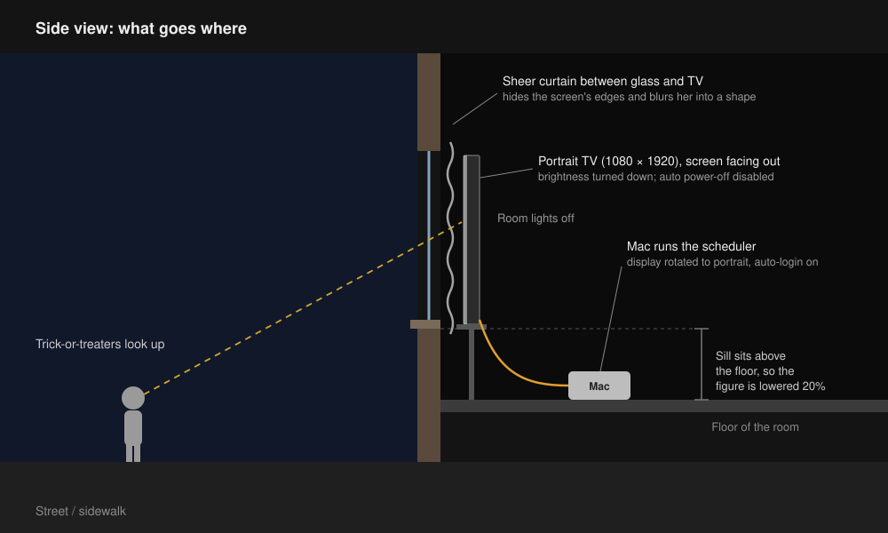

# Halloween Window Display

A shadowy woman appears in an upstairs window. She wanders past, vanishes, comes back and presses her hand against the glass. Later in the evening, a glowing neon monster joins her.

It's a portrait TV standing behind a sheer curtain, driven by a Mac that plays AI-generated videos on a schedule: gentler ones while kids are out trick-or-treating, scarier ones later in the evening.

<p align="center"></p>

**Contents**

1. [How it works](#how-it-works)
2. [Quick start](#quick-start)
3. [What you need](#what-you-need)
4. [The videos](#the-videos)
5. [Set up the Mac](#set-up-the-mac)
6. [Set up the window](#set-up-the-window)
7. [Override the schedule](#override-the-schedule)
8. [Day-to-day](#day-to-day)
9. [Upgrading from the single-video version](#upgrading-from-the-single-video-version)
10. [Troubleshooting](#troubleshooting)
11. [Files](#files)

## How it works



A Mac plays videos full-screen on a TV standing upright in the window, with a sheer curtain in front to hide the screen's edges. A schedule decides what plays when: the `kid` playlist early in the evening, the `grownup` playlist later, and plain black the rest of the time. The videos are kept in this repo, and the Mac pulls the latest at every login. A `show` command overrides the schedule, from the Mac or from your phone.

## Quick start

The videos are in this repo, so this is the whole Mac setup. Run it in Terminal, without `sudo`:

```sh
git clone https://github.com/ndipatri/HalloweenWindowDisplay.git ~/HalloweenWindowDisplay
cd ~/HalloweenWindowDisplay
bash scheduler/install.sh             # installs, copies the videos into ~/video-scheduler, starts
~/video-scheduler/show kid 5          # try it now: kid for 5 minutes
```

Then rotate the display to portrait, turn on automatic login, and turn off the TV's auto power-off ([details](#5-macos-settings)). To change the hours, see [Set the schedule](#1-set-the-schedule). To play something outside the schedule, see [Override the schedule](#override-the-schedule).

## What you need

- A TV or monitor that can stand vertically (this build uses 1080 × 1920).
- A Mac connected to it over HDMI. Any Mac that runs a recent macOS works.
- A sheer white or grey curtain for the window.
- Optional: an iPhone, to [switch videos from your phone](#from-your-phone).

## The videos

| Playlist | Video | Length |
|---|---|---|
| `kid` | `lady_silouette_long.mp4`: a shadowy woman walks past, presses her hand to the glass, and keeps coming back | 1:33 |
| `grownup` | `big_green_monster.mp4`: a glowing neon monster comes right up to the glass and stares out | 0:20 |
| `grownup` | `lady_silouette_long.mp4`: the same woman | 1:33 |

They're in [`playlists/`](playlists/), 1080 × 1920, silent, and each starts and ends on black so it loops without a visible jump.

### How they were made

The videos were made in a conversation with [Claude](https://claude.ai), Anthropic's AI assistant, connected to [Higgsfield](https://higgsfield.ai), an AI video service, through Higgsfield's connector (MCP). The person described what they wanted in plain words and reacted to each result; Claude turned that into prompts, generations and edits, and they went back and forth until it looked right:

1. **Describe the idea.** For example: "a woman who's just a dark silhouette, on black, walking in and out of frame, on a portrait TV in my window."
2. **Claude writes the prompt and generates.** It picked the model (Seedance 2.5, text-to-video), set the format (9:16, 1080p, 12–20 s, no audio), checked the credit cost, wrote the detailed prompt below, and started the generation on Higgsfield.
3. **Check the result.** Claude pulled frames from the clips to check the figure filled the frame and each clip started and ended on black, and the person watched them.
4. **Iterate on feedback.** "She should be much bigger, right at the window" led to a new prompt. "Lower her 20%, the window isn't at floor level" and "make it scarier" led to editing rather than regenerating: Claude used ffmpeg, in Higgsfield's cloud sandbox, to lower the picture, add a flicker and glitch flashes, and join the woman's two clips into one loop. The new hand-on-the-glass clip was the only extra generation. "Too much dead space" cut the loop from 4:20 to 1:33.
5. **Ship it.** Claude committed the finished videos here, along with the scheduler, installer and this README.

To make new videos the same way, you need a Higgsfield account, a Claude plan, and ffmpeg (`brew install ffmpeg`) to run `video/build_loop.sh`.

### What it cost

About **$47–56 in Higgsfield credits**, plus a **Claude subscription** (from $20 a month). Prices as of October 2026.

**Higgsfield** charges credits per generation; editing afterwards costs nothing. Four generations were made:

| Generation | Credits | ≈ Cost |
|---|---|---|
| Woman walking, first try (too small, discarded) | 320 | $13–16 |
| Woman walking, second try (used) | 320 | $13–16 |
| Woman, hand on the glass | 192 | $8–9 |
| Neon monster | 320 | $13–16 |
| **Total** | **1,152** | **$47–56** |

- By video: the woman's loop cost 832 credits (≈ $34–41, including the discarded try) and the monster 320 (≈ $13–16).
- Credits came with the **Plus** plan at **$49 a month**. The account received 1,200 credits for that, about 4¢ each; Higgsfield's published plan is 1,000 credits, about 4.9¢ each. Hence the ranges.
- One 20-second 1080p Seedance 2.5 clip is 320 credits; a 12-second one is 192, about 16 credits per second.
- Free after generation: lowering the picture 20%, the flicker and glitch flashes, fading the monster's top edge, and cutting the loop from 4:20 to 1:33.

**Claude** is a flat monthly subscription, not charged per video, so the conversation that wrote the prompts, checked and edited the videos, and wrote the scheduler, installer and this README cost nothing beyond the plan:

| Plan | Price | Usage |
|---|---|---|
| Free | $0 | Limited |
| Pro | $20/month ($17/month billed yearly) | Baseline |
| Max | $100/month | 5× Pro |
| Ultra | $200/month | 10× Pro |

All plans include connectors such as Higgsfield. A long working session like this one, spread over a couple of days, can reach Pro's usage limits; a higher plan gives more room.

Sources: [Higgsfield pricing (Oct 2026)](https://higgsfield.ai/blog/higgsfield-pricing-explained) · [Claude plans & pricing](https://claude.com/pricing)

### The prompts

**Woman, walk (20 s)**

> Static locked-off camera, vertical frame, pure black background, no environment, no floor, no light sources. The camera is right at a window looking into a dark room, and the woman stands directly against the glass, extremely close to camera. Her figure is huge and fills the entire height of the frame: the top of her head touches the top edge of the frame and her body extends down past the bottom edge. She is a solid jet-black silhouette, a featureless dark shape with only a faint soft grey rim of backlight tracing her outline: long hair, shoulders, a long dress. No face, no eyes, no details, no color. The video begins on an empty, fully black frame. She slowly steps in from the left edge, close to the glass and still filling the full frame height, drifts across, stops in the center facing the viewer as if pressed to the window staring out, sways slightly and tilts her head, then slides out of frame on the right. She re-enters from the right, again full height and close to the glass, then turns and slowly walks back into the darkness of the room, shrinking and fading until she dissolves into the black. The final seconds are an empty, fully black frame, identical to the opening. Slow, eerie, ghostly, unhurried, smooth movement. Minimal, haunting, high contrast, no text, no other people, no camera movement.

**Woman, hand on the glass (12 s)**

> Static locked-off camera, vertical frame, pure black background, no environment, no floor, no light sources. The camera is right at a window looking into a dark room. The video begins on an empty, fully black frame. A woman slowly emerges out of the darkness and stops directly against the glass, extremely close to camera, her figure huge and filling the entire height of the frame: the top of her head touches the top edge of the frame and her body extends past the bottom edge. She is a solid jet-black silhouette, a featureless dark shape with only a faint soft grey rim of backlight tracing her outline: long tangled hair, shoulders, a long dress. No face, no eyes, no details, no color. She stands perfectly, unnaturally still. Then her head slowly tilts downward, as if she has noticed someone on the street below. She slowly raises one hand and presses her palm flat against the glass, fingers spread, the hand silhouette large in the frame. She holds there, motionless. Suddenly her head snaps sharply to one side with a jerky, unnatural movement. Then she slowly sinks backward into the darkness and dissolves completely into the black. The final second is an empty, fully black frame. Eerie, unsettling, horror, high contrast, no text, no other people, no camera movement.

**Monster (20 s)**

> Static locked-off camera, vertical frame, pure black background, no environment, no floor, no light sources. The camera is right at a window looking into a pitch-dark room. The video begins on an empty, fully black frame. A tall, gaunt, terrifying monster slowly steps in from the left edge, directly against the glass, extremely close to camera. It is huge and fills the entire height of the frame: the top of its head touches the top edge of the frame and its body extends down past the bottom edge. The monster is vividly colorful against the blackness: slick iridescent skin shifting from toxic green to deep violet and magenta, glowing bioluminescent orange stripes and spots pulsing along its ribs and long arms, a crest of jagged cyan spines down its back, a wide mouth of crooked needle teeth, and two large glowing yellow eyes. Long spindly fingers with hooked claws. It is lit only by its own glow and a faint colored rim light, everything around it pitch black. It moves slowly and unnaturally, with jerky, twitching steps. It drifts across, stops in the center facing the viewer as if staring out the window, cocks its head, slowly breathes, then slides out of frame on the right. It re-enters from the right, close to the glass and still filling the full frame height, then turns and slowly retreats backward into the darkness of the room, shrinking as its glow dims until it dissolves completely into the black. The final seconds are an empty, fully black frame, identical to the opening. Eerie, menacing, horror, high contrast, saturated neon colors on pure black, no text, no other creatures or people, no camera movement.

## Set up the Mac

### 1. Set the schedule

Edit `CONFIG.schedule` near the top of `scheduler/video_scheduler.js`. Each period has a start and stop time in 24-hour `HH:MM` and the `playlist` to play.

```js
schedule: [
  { start: '05:00', stop: '07:00', playlist: 'kid' },
  { start: '17:00', stop: '20:00', playlist: 'kid' },
  { start: '20:00', stop: '23:00', playlist: 'grownup' },
],
```

This is the default: gentler videos in the early morning and during trick-or-treating, scarier ones once the little kids are home. Adjust the times to your street.

- Outside these times the screen shows black.
- Periods can cross midnight (`{ start: '23:00', stop: '01:00', playlist: 'grownup' }`). If periods overlap, the first one listed wins.
- Each playlist resumes where it left off. Above, the evening `kid` period carries on from where the morning one stopped.
- `playlist` is just a folder name, so you can add more playlists by creating another folder and naming it in the schedule.
- A malformed entry is skipped and reported in the log.

You can change the schedule any time later; run the installer again afterwards.

### 2. Install

```sh
bash scheduler/install.sh
```

Don't use `sudo`. The installer:

- copies the scheduler, the [`show` command](#override-the-schedule) and the [`sync` command](#3-add-the-videos) to `~/video-scheduler/`
- creates the `kid` and `grownup` playlist folders
- writes the launch agent with your home folder filled in, checks it, and starts it, which also copies the videos from the repo

It starts again by itself at every login, syncing the videos first. Run the installer again after any change to the script or schedule. It restarts the running copy with the new version; any override is kept.

> [!IMPORTANT]
> Keep the repo itself out of **Desktop**, **Documents** and **Downloads** (for example at `~/HalloweenWindowDisplay`). The installer warns you if it isn't: at login, macOS may not let the scheduler read those folders, so videos wouldn't sync.

### 3. Add the videos

The videos are kept in this repo, one folder per playlist, and copied to the Mac:

```
HalloweenWindowDisplay/playlists/        in the repo: the master copy
├── kid/                                 played during 'kid' periods
│   └── lady_silouette_long.mp4
└── grownup/                             played during 'grownup' periods
    ├── big_green_monster.mp4
    └── lady_silouette_long.mp4

~/video-scheduler/                       on the Mac: what actually plays
├── kid/ · grownup/                      copies of the playlists above
├── .removed/                            videos taken out of the repo, set aside
├── video_scheduler.js · start · sync · show
├── scheduler.log
├── status                               what's on screen now (written by the scheduler)
└── override.json                        only while an override is in force (written by show)
```

**To add, replace or remove a video**, change it in the repo and push. On the Mac:

```sh
cd ~/HalloweenWindowDisplay
cp ~/Downloads/new-ghost.mp4 playlists/kid/
git add playlists && git commit -m "Add new-ghost" && git push
~/video-scheduler/sync          # or wait for the next login
```

`sync` pulls the latest from GitHub, then for each folder in `playlists/`:

- copies in videos that are new or changed;
- moves videos that are no longer in the repo to `~/video-scheduler/.removed/<playlist>/`. It never deletes anything.

Playlist folders that aren't in the repo are left alone, so you can still keep a local-only playlist. The running scheduler picks the changes up by itself. If GitHub can't be reached, or doesn't answer within a minute, `sync` uses the videos already in the repo and the display carries on; it's all in the log.

> [!WARNING]
> Once `playlists/kid/` exists in the repo, it's the master copy: kid videos on the Mac that aren't in it are moved to `.removed/` at the next sync. Commit all your videos before relying on sync.

At login it syncs at most once every 10 minutes, so a scheduler that keeps crashing doesn't keep hitting GitHub; `~/video-scheduler/sync` always syncs. GitHub refuses files over 100 MB, so keep each video under that (the ones here are 18–28 MB).

- Videos play one after another, then start over from the first. Order is by file name, with numbers sorted as numbers (`2-…` before `10-…`), so a number prefix controls the order.
- `.mp4`, `.m4v` and `.mov` files are played; anything else in the folder is ignored.
- New videos are picked up within a few seconds, and videos you add or remove later are picked up as the playlist moves on. No restart needed.
- Videos are copied in under a hidden name and renamed into place, so a half-copied file is never played.
- A playlist with a single video simply loops it.
- An empty folder shows black during its periods, so fill both before Halloween night.

### 4. Check it's working

```sh
tail -f ~/video-scheduler/scheduler.log
```

You should see lines like:

```
10/31/2026, 5:00:00 PM  Now showing: kid (scheduled until 8:00 PM)
10/31/2026, 5:00:01 PM  kid: playing 1-friendly-ghost.mp4
10/31/2026, 5:01:12 PM  kid: playing 2-pumpkin.mp4
10/31/2026, 8:00:00 PM  Now showing: grownup (scheduled until 11:00 PM)
```

Outside the schedule it logs, for example, `Now showing: black (outside schedule until 5:00 PM)`. Press Control-C to stop watching the log; the scheduler keeps running.

To see a playlist right now without waiting for its time, override the schedule for a few minutes:

```sh
~/video-scheduler/show kid 5
```

### 5. macOS settings

| Setting | Where | Why |
|---|---|---|
| Rotate the display to portrait | System Settings → Displays → Rotation | The scheduler only uses a display that is taller than it is wide |
| Automatic login | System Settings → Users & Groups | The scheduler runs only while you're logged in. Not available while FileVault is on |
| Do Not Disturb on a schedule | System Settings → Focus → Do Not Disturb → Add Schedule | Stops notifications appearing over her |
| Don't auto-install macOS updates | System Settings → General → Software Update → Automatic Updates | An overnight update restart can leave the Mac at a login or setup screen |

## Set up the window

- **Hang the sheer curtain between the glass and the TV.** It hides the screen's edges and turns her into a blurry shape behind fabric. This helps more than anything else.
- **Turn every light in the room off** so nothing gives away that it's a screen.
- **Turn the TV's brightness down** until she's only just visible from the street. A dim figure reads as real; a bright one reads as a TV.
- **Turn off the TV's auto power-off.** Many TVs switch themselves off after about 4 hours without a remote button press. Look for "Auto Power Off", "Eco" or "4-hour off" in the TV's settings.
- Check it from the street after dark and adjust.

## Override the schedule

The `show` command plays something other than what the schedule says, right now. The scheduler picks it up within a second; there's nothing to restart.

```sh
show                           # what's on screen now, and why
show grownup 30                # grownup for 30 minutes, then back to the schedule
show kid                       # kid until the schedule next changes
show off                       # black until the schedule next changes
show grownup --until-cleared   # grownup until you say otherwise
show schedule                  # cancel any override; follow the schedule
```

```
$ show grownup 30
Showing grownup until 6:42 PM, then back to the schedule.
Now showing: grownup (override until 6:42 PM)
```

How long an override lasts:

| You type | It lasts until |
|---|---|
| `show grownup 30` | 30 minutes from now |
| `show grownup` | The schedule next changes. At 6 pm during `kid` (5–8 pm), that's 8 pm, when `grownup` starts anyway. Outside the schedule, it's the start of the next period |
| `show grownup --until-cleared` | You run `show schedule`, however long that is |

Overrides end by themselves unless you ask otherwise. That way a forgotten override can't leave the scary videos on at 7 am. An override survives a restart of the Mac, and each playlist still resumes where it left off.

`show` lives at `~/video-scheduler/show`. To type just `show`, add an alias once, then open a new Terminal window:

```sh
echo "alias show='$HOME/video-scheduler/show'" >> ~/.zshrc
```

Any playlist folder works: `show halloween-party 60` plays `~/video-scheduler/halloween-party/`.

### From your phone

The Mac is in a dark room behind the TV, so the handiest remote is your iPhone. The Shortcuts app can run `show` on the Mac over your home Wi-Fi. You don't need to install anything.

**On the Mac**

1. Open System Settings → General → Sharing, and turn on **Remote Login**.
2. Click the **ⓘ** next to it and set "Allow access for" to **Only these users**, with just your account.
3. Note the address shown there, for example `ssh alex@Alexs-Mac-mini.local`. You need the user name (`alex`) and host (`Alexs-Mac-mini.local`).

**On the iPhone**, once per button:

1. Open **Shortcuts**, tap **+**, then **Add Action**, and search for **Run Script over SSH**.
2. Fill in:
   - **Script:** `~/video-scheduler/show grownup 30`. Use the full path; the `show` alias doesn't apply over SSH.
   - **Host:** `Alexs-Mac-mini.local`
   - **User:** `alex`
   - **Authentication:** Password, or SSH Key (see below)
3. Add a **Show Result** action after it, so you see what `show` replied.
4. Name the shortcut (for example "Ghost: scary 30 min"), then use **Add to Home Screen** from the share menu.

A useful set of buttons:

| Shortcut | Script |
|---|---|
| Ghost: scary 30 min | `~/video-scheduler/show grownup 30` |
| Ghost: kids 30 min | `~/video-scheduler/show kid 30` |
| Ghost: off | `~/video-scheduler/show off` |
| Ghost: back to schedule | `~/video-scheduler/show schedule` |
| Ghost: what's on? | `~/video-scheduler/show` |

You can also run them with Siri: "Hey Siri, Ghost off."

> [!TIP]
> **Use an SSH key instead of storing your Mac password.** In the Run Script over SSH action, set Authentication to **SSH Key**, tap the key to generate one, then tap **Share Public Key** and choose **Copy**. With Universal Clipboard (same Apple Account, Bluetooth and Wi-Fi on), it's now on the Mac's clipboard too; otherwise AirDrop or email it to yourself and copy it there. Then on the Mac, add it to `~/.ssh/authorized_keys`:
> ```sh
> mkdir -p ~/.ssh && chmod 700 ~/.ssh
> pbpaste >> ~/.ssh/authorized_keys && chmod 600 ~/.ssh/authorized_keys
> ```
> Remote Login lets anyone on your network try to log in to the Mac with your account. Use a strong password, and consider turning Remote Login off again after Halloween.

## Day-to-day

| Task | How |
|---|---|
| Play something else right now | `show grownup 30`, `show off`, `show schedule` (see [Override the schedule](#override-the-schedule)) |
| See what's on screen | `show` |
| Add, remove or reorder videos | Change them in the repo's `playlists/` folder, commit and push, then `~/video-scheduler/sync` (or wait for the next login) |
| Get the latest videos now | `~/video-scheduler/sync` |
| Undo a removal | Move the file back from `~/video-scheduler/.removed/` and put it back in the repo |
| Change the schedule | Edit `scheduler/video_scheduler.js`, then run `bash scheduler/install.sh` |
| Get the latest version of this repo | `git pull`, then `bash scheduler/install.sh` |
| Restart | `launchctl kickstart -k gui/$(id -u)/com.user.videoscheduler` |
| Stop | `launchctl bootout gui/$(id -u)/com.user.videoscheduler` (starts again at next login) |
| Remove for good | Stop it, then `rm ~/Library/LaunchAgents/com.user.videoscheduler.plist` |
| Quit right now | Control-C on the display (click it first). Stays off until the next login or restart |
| See what it's doing | `cat ~/video-scheduler/scheduler.log` |

## Upgrading from the single-video version

The first version played one file, `~/video-scheduler/current.mp4`, and its schedule entries had no `playlist`. To move to playlists:

```sh
git pull
bash scheduler/install.sh                                         # installs the new script, creates kid/ and grownup/
mv ~/video-scheduler/current.mp4 ~/video-scheduler/grownup/haunted_window_loop.mp4
```

Then add videos to `kid/`. If you had edited the schedule, re-apply your times in the new format (each entry needs a `playlist`) and run the installer again. Old-style entries without a `playlist` are skipped and reported in the log, not guessed at.

## Troubleshooting

Start with the log: `cat ~/video-scheduler/scheduler.log`. It records what's showing and why whenever that changes, each video as it starts, overrides starting and ending, and any problem with a folder or file. For just the current state, run `show`.

| Problem | Fix |
|---|---|
| Log says `Cannot read the folder …` | The playlist folder doesn't exist, is misspelled in the schedule, or is in a protected folder. Run `bash scheduler/install.sh` to create `kid` and `grownup` |
| Log says `No videos in …` | Add `.mp4`, `.m4v` or `.mov` files to that folder. They start within a few seconds |
| Log says `Skipping …` | That file is damaged or in a format macOS can't play. Re-export it as H.264 MP4; the others keep playing |
| Black screen, log says `playing …` | Check the TV's input and brightness, and that the curtain isn't too thick |
| Screen isn't following the schedule | An override is probably in force. Run `show` to check, `show schedule` to cancel it |
| Log says `Couldn't pull from GitHub` | The Mac is offline or GitHub can't be reached; it plays the videos it already has. Check the network, then run `~/video-scheduler/sync`. If the reason mentions local changes, see [Updating](#day-to-day) |
| A video I added doesn't play | Check it's committed and pushed (`git status`), then run `~/video-scheduler/sync` and look for `Copied …` |
| A video disappeared from the Mac | It isn't in the repo's `playlists/` folder, so sync moved it to `~/video-scheduler/.removed/`. Add it to the repo |
| `show` says `No status yet` | The scheduler isn't running, or hasn't started since the upgrade. Run `bash scheduler/install.sh` |
| Log says `Ignoring …/override.json` | The override file was edited by hand and is malformed. Run `show schedule` to delete it |
| iPhone shortcut fails to connect | Check Remote Login is on, the phone is on your home Wi-Fi (not cellular), and the host and user match the Sharing settings. Try the Mac's IP address instead of its `.local` name |
| iPhone shortcut says `show: not found` | Use the full path, `~/video-scheduler/show` |
| Log says `Ignoring schedule entry` | Fix that entry: times must be `HH:MM` and it needs a `playlist` |
| Old `current.mp4` no longer plays | Move it into `kid/` or `grownup/`. See [Upgrading](#upgrading-from-the-single-video-version) |
| Nothing on the TV at all; the Mac desktop shows | The display isn't rotated to portrait, or the agent isn't running: `launchctl print gui/$(id -u)/com.user.videoscheduler` |
| TV turns itself off in the evening | Disable the TV's auto power-off (see above) |
| `Bootstrap failed: 5: Input/output error` | An older installer started the new copy before the old one had stopped. `git pull` and run `bash scheduler/install.sh` again |
| Installer says `still loaded after 10 seconds` | macOS didn't release the old copy. Log out and back in; the scheduler starts by itself at login |

## Files

| Path | What it is |
|---|---|
| `scheduler/video_scheduler.js` | Plays the scheduled playlist full-screen on the portrait display |
| `scheduler/com.user.videoscheduler.plist` | Launch agent template: starts the script at login and restarts it if it crashes |
| `scheduler/show.sh` | The `show` command for overriding the schedule (installed as `~/video-scheduler/show`) |
| `scheduler/start.sh` | Run at login: syncs the videos, then starts the scheduler (installed as `~/video-scheduler/start`) |
| `scheduler/sync_videos.sh` | Pulls the repo and copies `playlists/` into `~/video-scheduler` (installed as `~/video-scheduler/sync`) |
| `scheduler/install.sh` | Installs or updates the scheduler for the current user |
| `playlists/` | The videos, one folder per playlist |
| `video/build_loop.sh` | Builds the 1:33 loop from the two generated clips |
| `docs/images/` | Frames and diagrams used in this guide |
