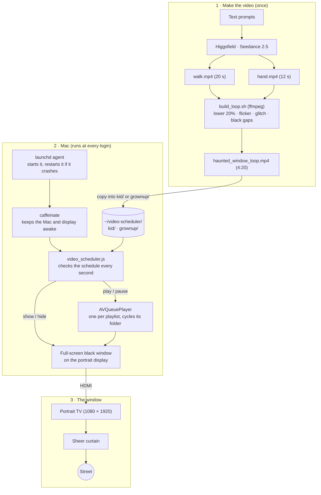
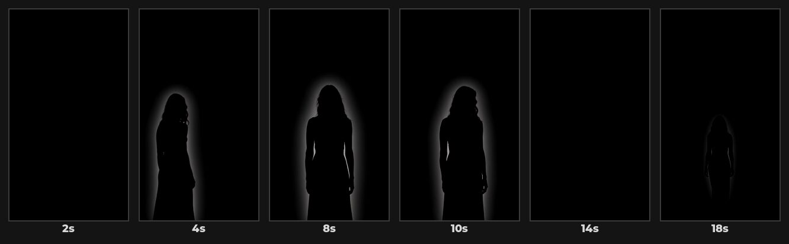
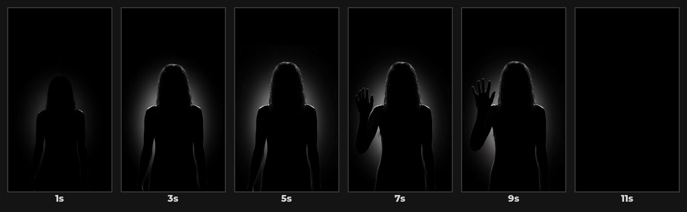
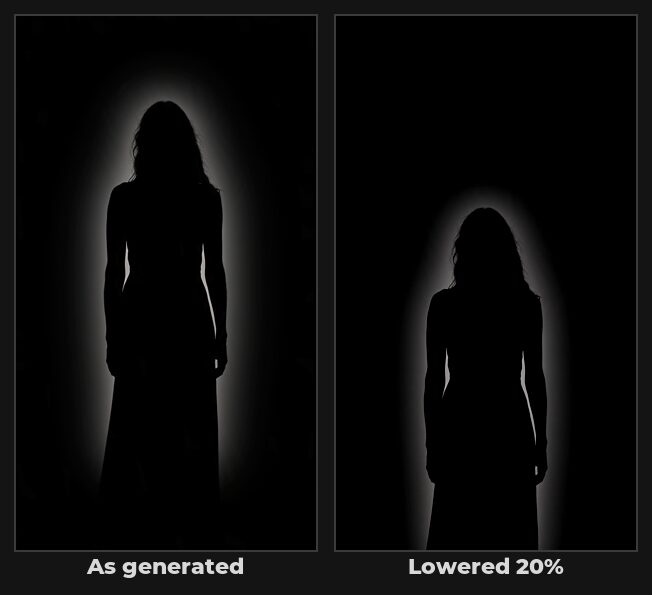
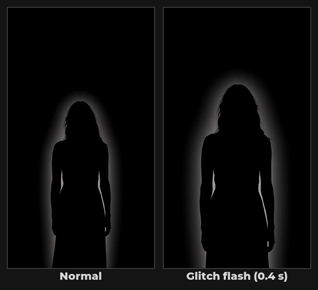
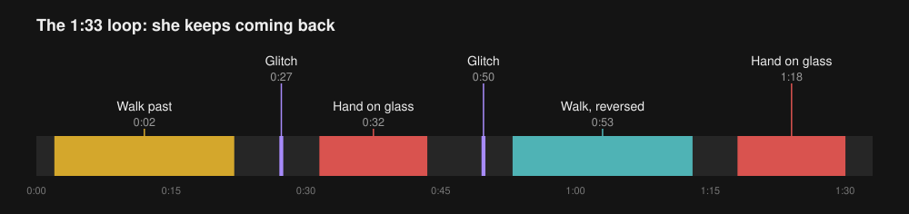

# Halloween Window Display

A shadowy woman appears in an upstairs window. She wanders past, vanishes, comes back and presses her hand against the glass. Most of the time the window is just dark, so people who catch her aren't sure what they saw.

It's a portrait TV standing behind a sheer curtain, driven by a Mac that plays AI-generated videos on a schedule: gentler ones while kids are out trick-or-treating, scarier ones later in the evening.

<p align="center"></p>

**Contents**

1. [Quick start](#quick-start)
2. [How it works](#how-it-works)
3. [What you need](#what-you-need)
4. [Make the video](#make-the-video)
5. [Set up the Mac](#set-up-the-mac)
6. [Set up the window](#set-up-the-window)
7. [Day-to-day](#day-to-day)
8. [Upgrading from the single-video version](#upgrading-from-the-single-video-version)
9. [Troubleshooting](#troubleshooting)
10. [Files](#files)

## Quick start

If you already have your videos, this is the whole Mac setup. Run it in Terminal, without `sudo`:

```sh
git clone https://github.com/ndipatri/HalloweenWindowDisplay.git
cd HalloweenWindowDisplay
bash scheduler/install.sh                                  # creates ~/video-scheduler/kid and grownup
cp haunted_window_loop.mp4 ~/video-scheduler/grownup/      # scary videos
cp friendly-ghost.mp4 ~/video-scheduler/kid/               # gentler videos
tail -f ~/video-scheduler/scheduler.log                    # watch it pick them up
```

Then rotate the display to portrait, turn on automatic login, and turn off the TV's auto power-off ([details](#5-macos-settings)). To change the hours, see [Set the schedule](#1-set-the-schedule).

## How it works




Two halves:

- **The video** is made once. An AI video model generates two short clips of a silhouette, and an ffmpeg script turns them into a 4 min 20 s loop that is mostly an empty dark window.
- **The scheduler** runs on the Mac. A launch agent starts it at login. It covers the portrait display with a black window. Each scheduled period names a playlist, `kid` or `grownup`, and during that period it cycles through every video in that playlist's folder. Outside the schedule it shows plain black. It uses macOS's built-in video player, so there's nothing to install apart from this repo.

## What you need

- A TV or monitor that can stand vertically (this build uses 1080 × 1920).
- A Mac connected to it over HDMI. Any Mac that runs a recent macOS works.
- A sheer white or grey curtain for the window.
- To make or change the video: a [Higgsfield](https://higgsfield.ai) account (about 512 credits for the two clips) and ffmpeg (`brew install ffmpeg`). Skip this if you already have your videos.

## Make the video

### 1. Generate the two clips

Both clips were made with **Seedance 2.5** on Higgsfield: text-to-video, 9:16, 1080p, no audio, high bitrate.

**Walk clip** (20 s, 320 credits). She walks in close to the glass, crosses, pauses facing out, leaves, comes back, then walks away into the room and fades out.

> Static locked-off camera, vertical frame, pure black background, no environment, no floor, no light sources. The camera is right at a window looking into a dark room, and the woman stands directly against the glass, extremely close to camera. Her figure is huge and fills the entire height of the frame: the top of her head touches the top edge of the frame and her body extends down past the bottom edge. She is a solid jet-black silhouette, a featureless dark shape with only a faint soft grey rim of backlight tracing her outline: long hair, shoulders, a long dress. No face, no eyes, no details, no color. The video begins on an empty, fully black frame. She slowly steps in from the left edge, close to the glass and still filling the full frame height, drifts across, stops in the center facing the viewer as if pressed to the window staring out, sways slightly and tilts her head, then slides out of frame on the right. She re-enters from the right, again full height and close to the glass, then turns and slowly walks back into the darkness of the room, shrinking and fading until she dissolves into the black. The final seconds are an empty, fully black frame, identical to the opening. Slow, eerie, ghostly, unhurried, smooth movement. Minimal, haunting, high contrast, no text, no other people, no camera movement.



**Hand clip** (12 s, 192 credits). She comes up to the glass, stands unnaturally still, then raises a hand and presses her palm flat against it.

> Static locked-off camera, vertical frame, pure black background, no environment, no floor, no light sources. The camera is right at a window looking into a dark room. The video begins on an empty, fully black frame. A woman slowly emerges out of the darkness and stops directly against the glass, extremely close to camera, her figure huge and filling the entire height of the frame: the top of her head touches the top edge of the frame and her body extends past the bottom edge. She is a solid jet-black silhouette, a featureless dark shape with only a faint soft grey rim of backlight tracing her outline: long tangled hair, shoulders, a long dress. No face, no eyes, no details, no color. She stands perfectly, unnaturally still. Then her head slowly tilts downward, as if she has noticed someone on the street below. She slowly raises one hand and presses her palm flat against the glass, fingers spread, the hand silhouette large in the frame. She holds there, motionless. Suddenly her head snaps sharply to one side with a jerky, unnatural movement. Then she slowly sinks backward into the darkness and dissolves completely into the black. The final second is an empty, fully black frame. Eerie, unsettling, horror, high contrast, no text, no other people, no camera movement.



What made the prompts work:

- **"Against the glass … fills the entire height of the frame."** The first attempt had her standing halfway back in the room, which looked too small from the street.
- **A faint grey rim of backlight.** A pure black figure on a black background is invisible. The rim is what people see.
- **Starts and ends on an empty black frame.** That's what lets the clips join, and the whole thing loop, without a visible jump.
- AI models don't always follow every beat of a prompt. Watch each clip before building, and regenerate if a key moment is missing.

### 2. Build the loop

```sh
bash video/build_loop.sh walk.mp4 hand.mp4 haunted_window_loop.mp4
```

This takes a few minutes and does four things.

**Lowers her by 20%.** The window sill is well above the floor of the room, so a figure standing on the bottom edge of the screen looks like she's floating. The script crops the bottom fifth and adds black at the top.



**Adds a flicker.** An uneven shimmer on her outline, like a dying bulb, with a split-second near-blackout every so often.

**Adds glitch flashes.** For 0.4 seconds she's suddenly much closer, then gone. It's brief enough that people doubt they saw it.



**Spaces everything out with black.** The window is empty about three-quarters of the time. One of her appearances is the walk clip played backwards, so her movement looks subtly wrong.



The output is 1080 × 1920 H.264, silent, about 28 MB. To change the look, edit `SHIFT`, `FLICKER` or the playlist near the bottom of the script.

## Set up the Mac

### 1. Set the schedule

Edit `CONFIG.schedule` near the top of `scheduler/video_scheduler.js`. Each period has a start and stop time in 24-hour `HH:MM` and the `playlist` to play.

```js
schedule: [
  { start: '05:00', stop: '07:00', playlist: 'kid' },
  { start: '17:00', stop: '20:00', playlist: 'kid' },
  { start: '20:00', stop: '23:00', playlist: 'grownup' },
],
```

This is the default: gentler videos in the early morning and during trick-or-treating, scarier ones once the little kids are home. Adjust the times to your street.

- Outside these times the screen shows black.
- Periods can cross midnight (`{ start: '23:00', stop: '01:00', playlist: 'grownup' }`). If periods overlap, the first one listed wins.
- Each playlist resumes where it left off. Above, the evening `kid` period carries on from where the morning one stopped.
- `playlist` is just a folder name, so you can add more playlists by creating another folder and naming it in the schedule.
- A malformed entry is skipped and reported in the log.

You can change the schedule any time later; run the installer again afterwards.

### 2. Install

```sh
bash scheduler/install.sh
```

Don't use `sudo`. The installer:

- copies the script to `~/video-scheduler/`
- creates the `kid` and `grownup` playlist folders
- writes the launch agent with your home folder filled in, checks it, and starts it

It starts again by itself at every login. Run the installer again after any change to the script or schedule; it replaces the running copy.

### 3. Add the videos

Each playlist is a folder in `~/video-scheduler/`:

```
~/video-scheduler/
├── video_scheduler.js
├── scheduler.log
├── kid/        played during 'kid' periods
│   ├── 1-friendly-ghost.mp4
│   └── 2-pumpkin.mp4
└── grownup/    played during 'grownup' periods
    └── haunted_window_loop.mp4
```

```sh
cp haunted_window_loop.mp4 ~/video-scheduler/grownup/
cp friendly-ghost.mp4 ~/video-scheduler/kid/
```

- Videos play one after another, then start over from the first. Order is by file name, with numbers sorted as numbers (`2-…` before `10-…`), so a number prefix controls the order.
- `.mp4`, `.m4v` and `.mov` files are played; anything else in the folder is ignored.
- New videos are picked up within a few seconds, and videos you add or remove later are picked up as the playlist moves on. No restart needed.
- A playlist with a single video simply loops it.
- An empty folder shows black during its periods, so fill both before Halloween night.

> [!IMPORTANT]
> Keep `~/video-scheduler` out of **Desktop**, **Documents** and **Downloads**. macOS protects those folders, and a background script can be silently refused access. Copy the videos *into* `~/video-scheduler`; don't leave them on the Desktop and link to them.

### 4. Check it's working

```sh
tail -f ~/video-scheduler/scheduler.log
```

During a scheduled period you should see lines like:

```
10/31/2026, 5:00:00 PM  Period started: kid
10/31/2026, 5:00:01 PM  kid: playing 1-friendly-ghost.mp4
10/31/2026, 5:01:12 PM  kid: playing 2-pumpkin.mp4
```

Outside the schedule it logs `Outside schedule: showing black.` Press Control-C to stop watching the log; the scheduler keeps running.

To try a playlist right now without waiting, temporarily add a period covering the current time, run the installer, and remove it again afterwards.

### 5. macOS settings

| Setting | Where | Why |
|---|---|---|
| Rotate the display to portrait | System Settings → Displays → Rotation | The scheduler only uses a display that is taller than it is wide |
| Automatic login | System Settings → Users & Groups | The scheduler runs only while you're logged in. Not available while FileVault is on |
| Do Not Disturb on a schedule | System Settings → Focus → Do Not Disturb → Add Schedule | Stops notifications appearing over her |
| Don't auto-install macOS updates | System Settings → General → Software Update → Automatic Updates | An overnight update restart can leave the Mac at a login or setup screen |

## Set up the window

- **Hang the sheer curtain between the glass and the TV.** It hides the screen's edges and turns her into a blurry shape behind fabric. This helps more than anything else.
- **Turn every light in the room off** so nothing gives away that it's a screen.
- **Turn the TV's brightness down** until she's only just visible from the street. A dim figure reads as real; a bright one reads as a TV.
- **Turn off the TV's auto power-off.** Many TVs switch themselves off after about 4 hours without a remote button press. Look for "Auto Power Off", "Eco" or "4-hour off" in the TV's settings.
- Check it from the street after dark and adjust.

## Day-to-day

| Task | How |
|---|---|
| Add, remove or reorder videos | Change the files in `~/video-scheduler/kid` or `grownup`. No restart needed |
| Change the schedule | Edit `scheduler/video_scheduler.js`, then run `bash scheduler/install.sh` |
| Get the latest version of this repo | `git pull`, then `bash scheduler/install.sh` |
| Restart | `launchctl kickstart -k gui/$(id -u)/com.user.videoscheduler` |
| Stop | `launchctl bootout gui/$(id -u)/com.user.videoscheduler` (starts again at next login) |
| Remove for good | Stop it, then `rm ~/Library/LaunchAgents/com.user.videoscheduler.plist` |
| Quit right now | Control-C on the display (click it first). Stays off until the next login or restart |
| See what it's doing | `cat ~/video-scheduler/scheduler.log` |

## Upgrading from the single-video version

The first version played one file, `~/video-scheduler/current.mp4`, and its schedule entries had no `playlist`. To move to playlists:

```sh
git pull
bash scheduler/install.sh                                         # installs the new script, creates kid/ and grownup/
mv ~/video-scheduler/current.mp4 ~/video-scheduler/grownup/haunted_window_loop.mp4
```

Then add videos to `kid/`. If you had edited the schedule, re-apply your times in the new format (each entry needs a `playlist`) and run the installer again. Old-style entries without a `playlist` are skipped and reported in the log, not guessed at.

## Troubleshooting

Start with the log: `cat ~/video-scheduler/scheduler.log`. It records each period starting and stopping, each video as it starts, and any problem with a folder or file.

| Problem | Fix |
|---|---|
| Log says `Cannot read the folder …` | The playlist folder doesn't exist, is misspelled in the schedule, or is in a protected folder. Run `bash scheduler/install.sh` to create `kid` and `grownup` |
| Log says `No videos in …` | Add `.mp4`, `.m4v` or `.mov` files to that folder. They start within a few seconds |
| Log says `Skipping …` | That file is damaged or in a format macOS can't play. Re-export it as H.264 MP4; the others keep playing |
| Black screen, log says `playing …` | Check the TV's input and brightness, and that the curtain isn't too thick |
| Log says `Ignoring schedule entry` | Fix that entry: times must be `HH:MM` and it needs a `playlist` |
| Old `current.mp4` no longer plays | Move it into `kid/` or `grownup/`. See [Upgrading](#upgrading-from-the-single-video-version) |
| Nothing on the TV at all; the Mac desktop shows | The display isn't rotated to portrait, or the agent isn't running: `launchctl print gui/$(id -u)/com.user.videoscheduler` |
| TV turns itself off in the evening | Disable the TV's auto power-off (see above) |
| `Bootstrap failed` or "already loaded" | Run `bash scheduler/install.sh` again. It stops the old copy first |

## Files

| Path | What it is |
|---|---|
| `scheduler/video_scheduler.js` | Plays the scheduled playlist full-screen on the portrait display |
| `scheduler/com.user.videoscheduler.plist` | Launch agent template: starts the script at login and restarts it if it crashes |
| `scheduler/install.sh` | Installs or updates the scheduler for the current user |
| `video/build_loop.sh` | Builds the 4:20 loop from the two generated clips |
| `docs/images/` | Frames and diagrams used in this guide |
